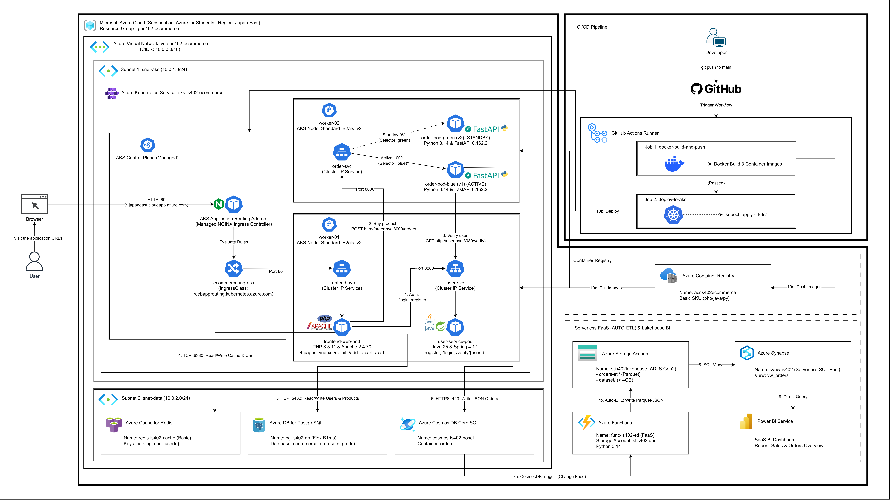

  

<h1 align="center"><b>IS402.R11 - ĐIỆN TOÁN ĐÁM MÂY</b></h1>

<b>Bài tập 07: Triển khai ứng dụng trên cloud (Cloud-native applications)</b>

<i>Nhóm ứng dụng: Thương mại điện tử (E-Commerce)</i>

---

## MỤC LỤC
- [1. Giới thiệu & Thành viên nhóm](#1-giới-thiệu--thành-viên-nhóm)
- [2. Kiến trúc & Công nghệ](#2-kiến-trúc--công-nghệ)
- [3. Hạ tầng và Pipeline](#3-hạ-tầng-và-pipeline)
- [4. Hướng dẫn khởi chạy](#4-hướng-dẫn-khởi-chạy)
- [5. Tài liệu tham khảo & tài liệu dự án](#5-tài-liệu-tham-khảo--tài-liệu-dự-án)

---

## 1. Giới thiệu & Thành viên nhóm

### 1.1 Thông tin đề tài
- **Môn học:** IS402 - Điện toán đám mây (IS402.R11 — HK2 2025-2026)
- **Đơn vị:** Khoa Hệ thống Thông tin — Trường Đại học Công nghệ Thông tin, ĐHQG-HCM (UIT)
- **Tên bài tập:** **Bài tập 07: Triển khai ứng dụng trên cloud (Cloud-native applications)**
- **Ngôn ngữ & Framework triển khai:** `PHP 8.5.11` (`Apache 2.4.70`), `Java 25` (`Spring Boot 4.1.2`), `Python 3.14` (`FastAPI 0.162.2`)
- **Mô tả đề tài:**  
  Xây dựng ứng dụng Web Thương mại điện tử theo kiến trúc Cloud-Native trên Microsoft Azure. Hệ thống đóng gói container chạy trên **AKS v1.32**, định tuyến qua **AKS Application Routing Add-on (Managed NGINX Ingress Controller)**, tự động hóa **CI/CD** qua GitHub Actions, kết hợp 3 dịch vụ lưu trữ quản lý (**PostgreSQL v18**, **Redis 7.2**, **Cosmos DB v4**), sử dụng **Azure Functions v4 (FaaS)** để tự động ETL dữ liệu đơn hàng mới sang **Azure Storage** phục vụ truy vấn dữ liệu lớn (`> 4GB`) trên **Azure Synapse Analytics** và hiển thị biểu đồ tổng quan trên **Power BI**.

### 1.2 Thành viên nhóm

| STT | MSSV | Họ và Tên | Vai trò chính trong dự án | Github | Email |
|:---:|:---:|:---|:---|:---|:---|
| 1 | 23521367 | **Ngô Tiến Sỹ** | **Trưởng nhóm** — Hạ tầng AKS v1.32 & Managed NGINX Ingress Add-on, K8s Blue/Green, CI/CD GitHub Actions, Benchmark `>4GB` & Cross-Region Latency | [@helios-ryuu](https://github.com/helios-ryuu) | 23521367@gm.uit.edu.vn |
| 2 | 23520214 | **Lê Quốc Đại** | Frontend Web 4 trang (`PHP 8.5.11`), User Service (`Java 25` & `Spring Boot 4.1.2`), Azure PostgreSQL v18 & Azure Cache for Redis 7.2 | [@daile2701](https://github.com/daile2701) | 23520214@gm.uit.edu.vn |
| 3 | 23521192 | **Đào Bảo Phúc** | Order Service (`Python 3.14` & `FastAPI 0.162.2`), Azure Cosmos DB, Azure Functions v4 (FaaS Auto-ETL), Synapse SQL & Power BI | [@baorphuc](https://github.com/baorphuc) | 23521192@gm.uit.edu.vn |

---

## 2. Kiến trúc & Công nghệ

### 2.1 Danh mục Công nghệ
- **Container, Orchestration & Ingress:** Docker `27.x`, Azure Container Registry (ACR), Azure Kubernetes Service (`AKS v1.32`), AKS Application Routing Add-on (`Managed NGINX Ingress Controller v1.11`).
- **Ứng dụng Web & Microservices:**
  - **Frontend Web (`PHP 8.5.11` + `Apache 2.4.70`):** 4 trang chức năng (Trang chủ, Trang chi tiết, Trang thêm vào giỏ hàng, Trang liệt kê giỏ hàng), kết nối Redis để đọc cache sản phẩm và quản lý giỏ hàng.
  - **User Service (`Java 25` + `Spring Boot 4.1.2`):** Quản lý đăng ký, đăng nhập tài khoản và API xác thực người dùng.
  - **Order Service (`Python 3.14` + `FastAPI 0.162.2`):** Xử lý mua sản phẩm, giao tiếp nội bộ với User Service, hỗ trợ triển khai Blue/Green.
- **Công nghệ Lưu trữ (Managed Services):**
  - **Azure Database for PostgreSQL (`Flexible Server v18`):** Lưu trữ bảng `users` và danh mục `products` gốc.
  - **Azure Cache for Redis (`Redis 7.2`):** Cache danh mục sản phẩm (`Cache-Aside`) và lưu giỏ hàng tạm thời.
  - **Azure Cosmos DB (`Core SQL API v4`):** Lưu trữ tài liệu đơn hàng (`orders`) tốc độ cao.
- **FaaS & Phân tích Dữ liệu (ETL + Analytics):**
  - **Azure Functions (`Runtime v4` - `Python 3.14`):** Tự động bắt sự kiện đơn hàng mới từ Cosmos DB và xuất sang Azure Storage (Auto-ETL).
  - **Azure Blob Storage / ADLS Gen2 (`StorageV2`):** Lưu trữ dữ liệu đơn hàng ETL và bộ Dataset `> 4GB` phục vụ benchmark.
  - **Azure Synapse Analytics & Power BI:** Truy vấn Serverless SQL trên Storage và hiển thị Dashboard tổng quan.

### 2.2 Sơ đồ Kiến trúc Tổng thể

  

Chi tiết sơ đồ kiến trúc và luồng xử lý 10 bước của hệ thống xem tại:
- [Thiết kế Kiến trúc Hệ thống (`architecture.md`)](./docs/2-planning-phase/architecture.md)

---

## 3. Hạ tầng và Pipeline

- **Hạ tầng Đám mây (Azure Infrastructure):**
  - Cụm **AKS `v1.32`** bật sẵn **Application Routing Add-on (Managed NGINX Ingress Controller `v1.11`)** (`IngressClass: webapprouting.kubernetes.azure.com`), truy cập qua tên miền miễn phí của Azure (`http://is402-ecommerce.japaneast.cloudapp.azure.com`).
  - Các dịch vụ `frontend-svc`, `user-svc`, `order-svc` hoạt động qua `ClusterIP` nội bộ; `order-svc` hỗ trợ chuyển đổi phiên bản **Blue/Green (`v1` / `v2`)** không gián đoạn.
- **Tự động hóa CI/CD (GitHub Actions):**
  - Tự động đóng gói Docker image cho 3 dịch vụ (`PHP 8.5.11`, `Java 25`, `Python 3.14`), đẩy lên **Azure Container Registry (ACR)** và cập nhật Kubernetes Manifests lên cụm **AKS**.

---

## 4. Hướng dẫn khởi chạy

*(Coming soon)*

---

## 5. Tài liệu tham khảo & tài liệu dự án

### 5.1 Tài liệu dự án
1. [Hiến chương Dự án (`project-charter.md`)](./docs/1-initiation-phase/project-charter.md)
2. [Thiết kế Kiến trúc Hệ thống (`architecture.md`)](./docs/2-planning-phase/architecture.md)
3. [Đặc tả Yêu cầu Chức năng (`functional-requirements.md`)](./docs/2-planning-phase/functional-requirements.md)
4. [Cấu trúc Phân rã Công việc & Tiến độ (`wbs.md`)](./docs/2-planning-phase/wbs.md)

### 5.2 Tài liệu tham khảo
1. [Microsoft Learn: Cloud-native applications architecture on Azure](https://learn.microsoft.com/en-us/azure/architecture/solution-ideas/articles/cloud-native-apps)
2. [Azure Kubernetes Service (AKS) Application Routing Add-on](https://learn.microsoft.com/en-us/azure/aks/app-routing)
