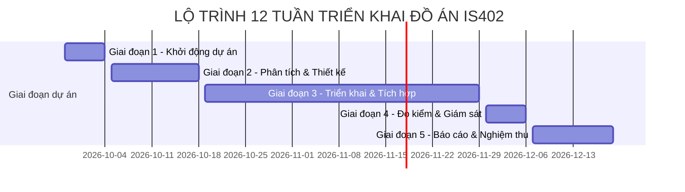

  

<h1 align="center"><b>IS402.R11 - ĐIỆN TOÁN ĐÁM MÂY</b></h1>

<b>Hiến chương dự án - Project Charter</b>

---

## MỤC LỤC
- [1. Thông tin chung](#1-thông-tin-chung)
  - [1.1 Thông tin đề tài](#11-thông-tin-đề-tài)
  - [1.2 Thành viên nhóm](#12-thành-viên-nhóm)
  - [1.3 Kế hoạch thời gian tổng thể](#13-kế-hoạch-thời-gian-tổng-thể)
- [2. Bối cảnh & Mục tiêu dự án](#2-bối-cảnh--mục-tiêu-dự-án)
  - [2.1 Bối cảnh thực tiễn](#21-bối-cảnh-thực-tiễn)
  - [2.2 Mục tiêu dự án](#22-mục-tiêu-dự-án)
- [3. Phạm vi dự án](#3-phạm-vi-dự-án)
  - [3.1 Trong phạm vi (In-Scope)](#31-trong-phạm-vi-in-scope)
  - [3.2 Ngoài phạm vi (Out-of-Scope)](#32-ngoài-phạm-vi-out-of-scope)
- [4. Đội ngũ thực hiện & Phân công trách nhiệm](#4-đội-ngũ-thực-hiện--phân-công-trách-nhiệm)
- [5. Kế hoạch triển khai & Sản phẩm bàn giao](#5-kế-hoạch-triển-khai--sản-phẩm-bàn-giao)
  - [5.1 Lộ trình các giai đoạn thực hiện](#51-lộ-trình-các-giai-đoạn-thực-hiện)
  - [5.2 Danh mục sản phẩm bàn giao (Deliverables)](#52-danh-mục-sản-phẩm-bàn-giao-deliverables)
- [6. Ngân sách & Quản trị tài nguyên](#6-ngân-sách--quản-trị-tài-nguyên)
- [7. Tiêu chí thành công & Nghiệm thu](#7-tiêu-chi-thành-công--nghiệm-thu)

---

## 1. Thông tin chung

### 1.1 Thông tin đề tài
- **Môn học:** IS402 - Điện toán đám mây (Lớp: IS402.R11)
- **Đơn vị:** Khoa Hệ thống Thông tin - Trường Đại học Công nghệ Thông tin, ĐHQG-HCM
- **Tên bài tập:** **Bài tập 07: Triển khai ứng dụng trên cloud (Cloud-native applications)**
- **Nhóm ứng dụng:** Thương mại điện tử (E-Commerce)
- **Tên dự án:** Triển khai ứng dụng thương mại điện tử Cloud-Native trên Microsoft Azure

### 1.2 Thành viên nhóm

| STT | MSSV | Họ và Tên | Vai trò chính | Email | Github |
|:---:|:---:|:---|:---|:---|:---|
| 1 | 23521367 | Ngô Tiến Sỹ | Trưởng nhóm — Quản trị Hạ tầng Cloud (AKS, VNet), Ingress NGINX, CI/CD Pipeline & FinOps | 23521367@gm.uit.edu.vn | [@helios-ryuu](https://github.com/helios-ryuu) |
| 2 | 23520214 | Lê Quốc Đại | Thành viên — Frontend Web (PHP/CDN), User Service (Java Spring Boot), PostgreSQL 18 & Redis Cache | 23520214@gm.uit.edu.vn | [@daile2701](https://github.com/daile2701) |
| 3 | 23521192 | Đào Bảo Phúc | Thành viên — Order Service (FastAPI), Azure Cosmos DB, Azure Functions (FaaS), Dataset Parquet & Power BI | 23521192@gm.uit.edu.vn | [@baorphuc](https://github.com/baorphuc) |

### 1.3 Kế hoạch thời gian tổng thể
Dự án được thực hiện trong 12 tuần (28/09/2026 – 19/12/2026), chia thành 5 giai đoạn:

| Giai đoạn | Thời gian | Nội dung công việc chính |
|:---|:---:|:---|
| **1. Khởi động dự án** | 28/09 – 04/10/2026 | Khảo sát bài toán, xác định phạm vi, lập Project Charter. |
| **2. Phân tích & Thiết kế** | 05/10 – 18/10/2026 | Thiết kế kiến trúc phân tán, thiết kế cơ sở dữ liệu và luồng dữ liệu. |
| **3. Triển khai & Tích hợp** | 19/10 – 29/11/2026 | Cấp phát tài nguyên Azure, phát triển microservices, CI/CD, FaaS và Power BI. |
| **4. Đo kiểm & Giám sát** | 30/11 – 06/12/2026 | Kiểm thử tải, đo độ trễ đọc/ghi, phân tích đối sánh và kiểm soát chi phí. |
| **5. Báo cáo & Nghiệm thu** | 07/12 – 19/12/2026 | Hoàn thiện báo cáo kỹ thuật, slide thuyết trình, video demo và bảo vệ đồ án. |

---

## 2. Bối cảnh & Mục tiêu dự án

### 2.1 Bối cảnh thực tiễn
Trong lĩnh vực thương mại điện tử (E-Commerce), hệ thống thường xuyên phải đối mặt với các đợt lưu lượng truy cập tăng vọt (Flash Sale, khuyến mãi lớn). Các kiến trúc nguyên khối truyền thống (Monolithic) gặp nhiều hạn chế:
- **Khó khăn khi mở rộng:** Khi lượng người duyệt hàng tăng cao, toàn bộ ứng dụng phải scale cùng lúc, gây lãng phí tài nguyên và dễ nghẽn CPU/RAM máy chủ.
- **Rủi ro gián đoạn khi cập nhật:** Mỗi bản cập nhật đều yêu cầu triển khai lại toàn bộ hệ thống, dễ dẫn đến downtime gián đoạn mua sắm của khách hàng.
- **Xung đột tài nguyên giữa giao dịch và phân tích:** Việc chạy các báo cáo kinh doanh trực tiếp trên cơ sở dữ liệu giao dịch chính làm chậm tốc độ phản hồi của website.

Giải pháp là chuyển đổi sang kiến trúc **Cloud-Native**, tận dụng sức mạnh điều phối container của **Azure Kubernetes Service (AKS)**, đa dạng hóa lưu trữ với các dịch vụ quản lý của Azure (**Polyglot Persistence**), xử lý nền theo sự kiện qua **Serverless (FaaS)** và tách riêng tầng phân tích dữ liệu lớn với **Azure Synapse Analytics & Power BI**.

### 2.2 Mục tiêu dự án
Dự án hướng đến việc hiện thực hóa một hệ thống thương mại điện tử hoàn chỉnh trên Microsoft Azure với các mục tiêu cụ thể:
1. **Kiến trúc Microservices trên AKS:** Triển khai 3 dịch vụ độc lập viết bằng 3 ngôn ngữ khác nhau (PHP, Java, Python), giao tiếp an toàn qua mạng nội bộ Kubernetes và định tuyến qua Ingress NGINX.
2. **Đa dạng hóa công nghệ lưu trữ đám mây:**
   - **Azure Cache for Redis:** Lưu trữ phiên làm việc (Session) và bộ nhớ đệm danh mục sản phẩm (< 1ms).
   - **Azure Database for PostgreSQL:** Lưu trữ thông tin người dùng và lịch sử mua bán đảm bảo chuẩn ACID.
   - **Azure Cosmos DB:** Lưu trữ giỏ hàng và dữ liệu đơn hàng phân tán với độ trễ thấp (< 10ms).
3. **Triển khai Blue/Green Deployment:** Cập nhật phiên bản mới cho Order Service mà không gây gián đoạn dịch vụ (Zero-downtime) thông qua Kubernetes Service Selector.
4. **Xử lý nền hướng sự kiện bằng Serverless (FaaS):** Sử dụng **Azure Functions** lắng nghe sự kiện từ Cosmos DB Change Feed để tự động tạo hóa đơn điện tử lưu vào Azure Blob Storage.
5. **Phân tích dữ liệu lớn & Trực quan hóa (BI):** Lưu trữ hồ dữ liệu giao dịch (> 4GB) dưới dạng Parquet trên Azure Data Lake Storage Gen2 (ADLS Gen2), truy vấn qua Azure Synapse Serverless SQL và xây dựng Dashboard trên Power BI Service hỗ trợ phân quyền theo dòng (Row-Level Security).
6. **Tự động hóa CI/CD:** Xây dựng quy trình tự động build, kiểm tra an toàn và deploy bằng GitHub Actions và Azure Container Registry (ACR).

---

## 3. Phạm vi dự án

### 3.1 Trong phạm vi (In-Scope)

| Nhóm phân hệ | Hạng mục triển khai chi tiết |
|:---|:---|
| **Workloads (Microservices)** | • **Frontend Web Service (PHP 8.5 & Apache):** 4 màn hình chức năng (Trang chủ, Chi tiết sản phẩm, Giỏ hàng, Đặt hàng/Thanh toán), kết nối Redis session. • **User Service (Java 25 & Spring Boot):** Quản lý tài khoản, đăng nhập, cấp và xác thực mã JWT an toàn. • **Order Service (Python 3.14 & FastAPI):** Xử lý đơn hàng, kho hàng, thanh toán mô phỏng (Mock Payment) và cơ chế phát hành Blue/Green. |
| **Hạ tầng Container & Mạng** | • Cụm **Azure Kubernetes Service (AKS)** v1.31 phân chia rõ namespace mạng (`ingress-nginx`) và nghiệp vụ (`ecommerce-prod`). • **Ingress NGINX Controller** kết hợp **Azure Public Load Balancer (L4)**, chứng thực SSL/TLS termination tại cổng 443. • Cấu hình Horizontal Pod Autoscaler (HPA) tự động co giãn pod theo mức sử dụng CPU. |
| **Cơ sở dữ liệu (PaaS)** | • **Azure Cache for Redis:** Quản lý session và cache danh mục. • **Azure DB for PostgreSQL Flexible Server:** Dữ liệu người dùng, phân quyền ACID. • **Azure Cosmos DB (Core SQL API):** Giỏ hàng và tài liệu đơn hàng. |
| **Xử lý ngầm (FaaS)** | • **Azure Functions (Python):** Kích hoạt bởi Cosmos DB Change Feed, xuất file hóa đơn PDF lưu vào Azure Blob Storage (container `invoices`) và ghi log thông báo. |
| **Phân tích dữ liệu (Lakehouse & BI)** | • **ADLS Gen2:** Lưu trữ tập dữ liệu phân tích lịch sử (> 4GB) định dạng Apache Parquet Snappy. • **Azure Synapse Analytics (Serverless SQL):** Khởi tạo External Star Schema Views truy vấn trực tiếp hồ dữ liệu Parquet. • **Power BI Service:** Dashboard 4 góc nhìn phân tích kết nối qua DirectQuery, thiết lập Dynamic RLS theo khu vực và bố cục Mobile 9:16. |
| **CI/CD & Quản trị** | • **GitHub Actions:** Tự động hóa build Docker image, kiểm tra bảo mật bằng Trivy Scanner và deploy lên AKS. • **Azure Container Registry (ACR):** Quản lý image an toàn. • **FinOps:** Giám sát chi phí qua Azure Cost Management đảm bảo trong hạn mức 100$. |

### 3.2 Ngoài phạm vi (Out-of-Scope)
- Không kết nối trực tiếp cổng thanh toán ngân hàng thật (dùng Mock Payment để phục vụ học tập).
- Không triển khai kiến trúc đa vùng chủ động (Multi-region Active-Active) để tiết kiệm ngân sách tài trợ.
- Không tự quản trị máy chủ vật lý hay cài đặt hệ điều hành máy chủ (sử dụng 100% dịch vụ PaaS/FaaS của Azure).
- Không huấn luyện các mô hình Machine Learning/Deep Learning phức tạp (tập trung vào kiến trúc đám mây và BI).
- Không phát triển ứng dụng di động native (giao diện web được tối ưu responsive và Power BI hỗ trợ app di động).

---

## 4. Đội ngũ thực hiện & Phân công trách nhiệm

Hệ thống được chia sẻ và phối hợp giữa 3 thành viên với trách nhiệm cụ thể như sau:

| Thành viên | Trách nhiệm chính trong đồ án | Sản phẩm đầu ra phụ trách |
|:---|:---|:---|
| **Ngô Tiến Sỹ** *(Trưởng nhóm)* | • Thiết kế kiến trúc tổng thể hệ thống đám mây. • Khởi tạo hạ tầng Azure (VNet, Subnets, AKS Cluster). • Cấu hình Ingress NGINX Controller, chứng chỉ SSL/TLS và Load Balancer. • Xây dựng quy trình CI/CD qua GitHub Actions, ACR và Trivy Scan. • Cấu hình hồ lưu trữ ADLS Gen2, Synapse Serverless SQL Views và quản lý chi phí FinOps. | • Kịch bản triển khai hạ tầng & manifests K8s. • Workflows GitHub Actions. • SQL Views trên Synapse Analytics. • Báo cáo đối sánh hiệu năng & FinOps. |
| **Lê Quốc Đại** *(Thành viên)* | • Phát triển Frontend Web Service (PHP 8.5 & Apache) với 4 giao diện nghiệp vụ. • Phát triển User Service (Java 25 & Spring Boot) xử lý đăng ký, đăng nhập và JWT. • Thiết kế cơ sở dữ liệu quan hệ trên Azure PostgreSQL Flexible Server. • Cấu hình và kết nối tầng nhớ đệm Azure Cache for Redis. • Đóng gói Dockerfile cho Frontend và User Service. | • Mã nguồn Frontend Web Service. • Mã nguồn User Service. • Schema PostgreSQL & cấu hình Redis. • Dockerfile & cấu hình liên quan. |
| **Đào Bảo Phúc** *(Thành viên)* | • Phát triển Order Service (Python 3.14 & FastAPI) xử lý giỏ hàng, đặt hàng và Blue/Green. • Thiết kế cấu trúc NoSQL và Partition Key trên Azure Cosmos DB. • Xây dựng Azure Functions (FaaS) bắt sự kiện Change Feed để tạo hóa đơn PDF lưu Blob. • Chuẩn bị tập dữ liệu mẫu (> 4GB) Parquet Snappy phân vùng trên ADLS Gen2. • Thiết kế Dashboard trên Power BI Service (DirectQuery, RLS, Mobile Layout). | • Mã nguồn Order Service. • Mã nguồn Azure Functions. • Bộ dữ liệu Parquet > 4GB. • Dashboard Power BI Service. |

---

## 5. Kế hoạch triển khai & Sản phẩm bàn giao

### 5.1 Lộ trình các giai đoạn thực hiện

- **Mốc 1 (04/10/2026):** Hoàn thành khảo sát và thống nhất tài liệu Project Charter.
- **Mốc 2 (18/10/2026):** Hoàn thiện hồ sơ thiết kế kiến trúc hệ thống (`architecture.md`, `arch.txt`).
- **Mốc 3 (01/11/2026):** Cấp phát thành công hạ tầng mạng VNet, cụm AKS và các cơ sở dữ liệu PaaS trên Azure.
- **Mốc 4 (15/11/2026):** Hoàn thành container hóa 3 microservices, Ingress NGINX và pipeline CI/CD GitHub Actions.
- **Mốc 5 (29/11/2026):** Hoàn tất Azure Functions xử lý sự kiện, nạp tập dữ liệu Parquet > 4GB và kết nối Power BI Dashboard.
- **Mốc 6 (06/12/2026):** Hoàn tất kiểm thử tải, kiểm tra co giãn HPA và báo cáo phân tích chi phí Azure.
- **Mốc 7 (19/12/2026):** Hoàn thiện báo cáo kỹ thuật, slide thuyết trình và bảo vệ nghiệm thu đồ án.

### 5.2 Danh mục sản phẩm bàn giao (Deliverables)

| Mã | Sản phẩm bàn giao (Deliverables) | Mô tả chi tiết |
|:---:|:---|:---|
| **D01** | **Hiến chương dự án (Project Charter)** | Tài liệu xác định thông tin chung, bối cảnh, mục tiêu, phạm vi và kế hoạch thực hiện. |
| **D02** | **Tài liệu Kiến trúc hệ thống** | Tài liệu chi tiết mô hình kiến trúc (`architecture.md` và `arch.txt`), sơ đồ Mermaid và cẩm nang thiết kế. |
| **D03** | **Mã nguồn Frontend Web Service** | Ứng dụng web PHP 8.5 chạy trên Apache, hiện thực 4 giao diện nghiệp vụ và kết nối Redis cache. |
| **D04** | **Mã nguồn User Service** | Ứng dụng Java 25 / Spring Boot xử lý xác thực tài khoản, cấp phát token JWT và kết nối PostgreSQL. |
| **D05** | **Mã nguồn Order Service** | Ứng dụng Python 3.14 / FastAPI xử lý giỏ hàng, đơn hàng, thanh toán mô phỏng và hỗ trợ Blue/Green. |
| **D06** | **Bộ tệp Kubernetes Manifests** | Cấu hình triển khai Deployments, ClusterIP Services, Ingress NGINX, HPA và Secrets trên AKS. |
| **D07** | **Workflows CI/CD GitHub Actions** | Kịch bản tự động build Docker image, quét bảo mật Trivy và triển khai tự động lên cụm AKS. |
| **D08** | **Mã nguồn Azure Functions (FaaS)** | Hàm Python kích hoạt tự động theo Cosmos DB Change Feed để tạo hóa đơn PDF lưu Blob Storage. |
| **D09** | **Mô hình Dữ liệu Lakehouse** | Tập dữ liệu Parquet (> 4GB) trên ADLS Gen2 và bộ SQL External Views trên Azure Synapse. |
| **D10** | **Bảng điều khiển Power BI Dashboard** | Dashboard 4 trang báo cáo kết nối DirectQuery tới Synapse, hỗ trợ Dynamic RLS và Mobile Layout. |
| **D11** | **Hồ sơ Báo cáo tổng kết & Slide** | Báo cáo kỹ thuật chi tiết (.docx), Slide thuyết trình (.pptx) và video kịch bản demo hệ thống. |

---

## 6. Ngân sách & Quản trị tài nguyên

### 6.1 Nguồn ngân sách và hạn mức
- Dự án khai thác gói tài trợ học tập **Azure for Students** với hạn mức **$100.00 USD**.
- Mục tiêu quản trị chi phí: Vận hành toàn bộ hệ thống phục vụ kiểm thử và demo trong giới hạn **$60 – $70 USD**, giữ mức an toàn không vượt quá hạn mức được cấp.

### 6.2 Bảng dự toán chi phí vận hành ước tính

| Dịch vụ Azure | Cấu hình & Bậc dịch vụ (SKU) | Cách thức tối ưu | Chi phí ước tính |
|:---|:---|:---|:---:|
| **Azure Kubernetes Service (AKS)** | 2 x VM Standard_D2s_v5 (Worker Nodes) | Bật khi phát triển và test; tắt khi nhàn rỗi | ~$24.00 USD |
| **PostgreSQL Flexible Server** | Burstable B1ms (1 vCPU, 2GB RAM, 32GB SSD) | Cấu hình tối thiểu đủ cho đồ án | ~$18.00 USD |
| **Azure Cache for Redis** | Basic Tier C0 (250MB) | Sử dụng gói cơ bản cho nhu cầu session/cache | ~$8.00 USD |
| **Azure Cosmos DB** | Core SQL API | Tận dụng định mức Free Tier (1000 RU/s, 25GB) | **$0.00 USD** |
| **Azure Functions** | Consumption Plan Y1 | Gói tiêu thụ miễn phí 1 triệu lượt gọi/tháng | **$0.00 USD** |
| **ADLS Gen2 Storage** | Standard Hot Tier (~5.5GB Parquet) | Dung lượng nhỏ, chi phí lưu trữ tối thiểu | ~$1.00 USD |
| **Azure Synapse Analytics** | Serverless SQL Pool | Chỉ tính phí theo dung lượng quét ($5/TB) | ~$2.00 USD |
| **Azure Container Registry (ACR)** | Basic Tier | Lưu trữ Docker images của nhóm | ~$7.00 USD |
| **Băng thông & Load Balancer** | Azure Public Load Balancer L4 | 1 IP public cho Ingress NGINX | ~$4.00 USD |
| **TỔNG DỰ TOÁN** | | | **~$64.00 USD** |

### 6.3 Giải pháp kiểm soát chi phí (FinOps)
1. **Chính sách tắt tài nguyên khi không sử dụng:** Tự động tắt/deallocate các máy ảo Worker Nodes của AKS ngoài giờ làm việc để tránh lãng phí.
2. **Cảnh báo ngân sách (Budget Alerts):** Thiết lập cảnh báo tự động trên Azure Cost Management khi chi phí chạm mốc 50%, 75% và 90% ngân sách dự toán.
3. **Gắn thẻ tài nguyên (Tagging):** Mọi tài nguyên đều được gắn thẻ `Project=IS402-CloudNative` để dễ dàng tra cứu và đối chiếu chi phí.

---

## 7. Tiêu chí thành công & Nghiệm thu

Hệ thống đồ án được đánh giá là hoàn thành tốt khi thỏa mãn các tiêu chí kỹ thuật sau:

| STT | Hạng mục kiểm tra | Tiêu chí nghiệm thu cụ thể | Trạng thái cam kết |
|:---:|:---|:---|:---:|
| 1 | **Triển khai trên AKS** | 3 dịch vụ vi mô (PHP, Java, Python) đóng gói container và chạy ổn định trên AKS; giao tiếp qua ClusterIP. | Hoàn thành |
| 2 | **Mạng biên & Bảo mật** | Ingress NGINX tiếp nhận và định tuyến HTTPS (cổng 443) tới đúng dịch vụ; hoàn tất SSL/TLS termination. | Hoàn thành |
| 3 | **Bộ nhớ đệm Redis** | Frontend lưu phiên làm việc và đọc cache danh mục từ Redis với phản hồi nhanh (< 1ms). | Hoàn thành |
| 4 | **CSDL PostgreSQL** | User Service thực hiện các thao tác đăng ký, đăng nhập và lưu trữ an toàn tuân thủ giao dịch ACID. | Hoàn thành |
| 5 | **CSDL Cosmos DB** | Order Service lưu trữ và truy vấn giỏ hàng/đơn hàng với độ trễ thấp (< 10ms). | Hoàn thành |
| 6 | **Blue/Green Deployment** | Hoán đổi nhãn Kubernetes Service Selector giữa bản Blue và Green mà không phát sinh thời gian chết (0% Downtime). | Hoàn thành |
| 7 | **Xử lý nền Serverless** | Azure Functions tự động bắt sự kiện Cosmos DB Change Feed để tạo file hóa đơn PDF lưu vào Azure Blob Storage. | Hoàn thành |
| 8 | **Hồ dữ liệu Parquet** | Tập dữ liệu phân tích đạt dung lượng lớn (> 4GB), lưu trữ dạng cột nén Snappy trên ADLS Gen2. | Hoàn thành |
| 9 | **Synapse Analytics** | Tạo External Views trên Synapse Serverless SQL để truy vấn và tổng hợp dữ liệu Parquet nhanh chóng. | Hoàn thành |
| 10 | **Power BI Dashboard** | Dashboard 4 trang báo cáo hoạt động tốt qua DirectQuery, thiết lập phân quyền Dynamic RLS và hỗ trợ xem trên di động. | Hoàn thành |
| 11 | **Tự động hóa CI/CD** | Pipeline GitHub Actions tự động build, kiểm tra bảo mật bằng Trivy và triển khai lên cụm AKS. | Hoàn thành |
| 12 | **Kiểm soát ngân sách** | Toàn bộ quá trình triển khai nằm gọn trong hạn mức tài trợ $100 của Azure for Students. | Hoàn thành |
