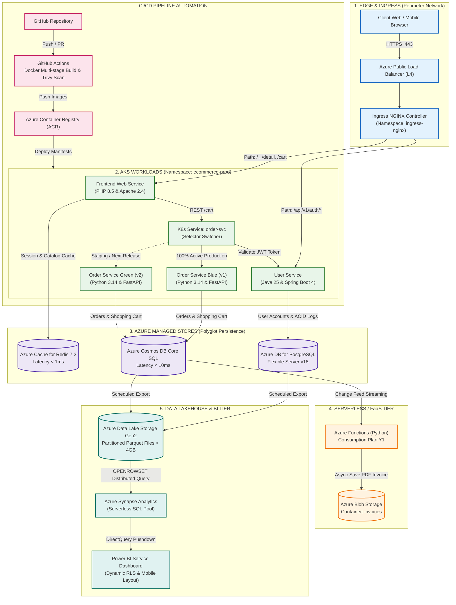

<p align="center">
  <a href="https://www.uit.edu.vn/" title="Trường Đại học Công nghệ Thông tin">
    
  </a>
</p>
<h1 align="center"><b>IS402.R11 - ĐIỆN TOÁN ĐÁM MÂY</b></h1>
<p align="center"><b>Thiết kế Kiến trúc Hệ thống Cloud-Native E-Commerce trên Microsoft Azure</b></p>

---

## MỤC LỤC
- [1. Tổng quan Kiến trúc](#1-tổng-quan-kiến-trúc)
- [2. Sơ đồ Kiến trúc Hệ thống (Architecture Diagram)](#2-sơ-đồ-kiến-trúc-hệ-thống-architecture-diagram)
- [3. Phân loại theo Mô hình Dịch vụ Đám mây (IaaS, PaaS, FaaS, SaaS)](#3-phân-loại-theo-mô-hình-dịch-vụ-đám-mây-iaas-paas-faas-saas)
- [4. Chi tiết các Vi dịch vụ (Microservices Workloads)](#4-chi-tiết-các-vi-dịch-vụ-microservices-workloads)
- [5. Các Luồng Dữ liệu & Xử lý Nghiệp vụ (Data Flows)](#5-các-luồng-dữ-liệu--xử-lý-nghiệp-vụ-data-flows)
- [6. Mô hình Dữ liệu & Lưu trữ Đa tầng (Storage & Lakehouse)](#6-mô-hình-dữ-liệu--lưu-trữ-đa-tầng-storage--lakehouse)
- [7. Cơ chế Triển khai Blue/Green & Tự động hóa CI/CD](#7-cơ-chế-triển-khai-bluegreen--tự-động-hóa-cicd)

---

## 1. Tổng quan Kiến trúc

Hệ thống Thương mại điện tử được thiết kế theo kiến trúc **Cloud-Native phân tán**, vận hành hoàn toàn trên nền tảng đám mây **Microsoft Azure**. Mục tiêu trọng tâm là giải quyết các bài toán về:
- Khả năng chịu tải đột biến (Spiky traffic) trong các đợt Flash Sale.
- Cập nhật phiên bản liên tục không gây gián đoạn (Zero-downtime deployment).
- Phân tách triệt để giữa tải giao dịch trực tuyến (OLTP) và tải phân tích dữ liệu kinh doanh (OLAP).
- Tận dụng tối đa các dịch vụ quản lý toàn diện (Managed Services) để tối ưu chi phí vận hành.

---

## 2. Sơ đồ Kiến trúc Hệ thống (Architecture Diagram)



---

## 3. Phân loại theo Mô hình Dịch vụ Đám mây (IaaS, PaaS, FaaS, SaaS)

Hệ thống được thiết kế bằng cách kết hợp hài hòa cả 4 mô hình dịch vụ đám mây trên Microsoft Azure:

| Mô hình | Thành phần triển khai trong dự án | Vai trò và Lý do lựa chọn |
|:---|:---|:---|
| **IaaS**<br>*(Hạ tầng)* | • **AKS Worker Nodes:** Máy ảo `Standard_D2s_v5` chạy container.<br>• **Azure Virtual Network (VNet):** Phân chia `snet-aks` và `snet-db`.<br>• **Network Security Group (NSG):** Kiểm soát truy cập mạng giữa các subnet. | Cung cấp tài nguyên tính toán (vCPU/RAM) linh hoạt và đảm bảo khả năng cô lập bảo mật mạng riêng biệt. |
| **PaaS**<br>*(Nền tảng)* | • **AKS Control Plane:** Master nodes do Azure tự động quản lý.<br>• **PostgreSQL Flexible Server:** CSDL quan hệ ACID tự động backup.<br>• **Azure Cosmos DB (Core SQL):** CSDL NoSQL phân tán toàn cầu.<br>• **Azure Cache for Redis:** Bộ nhớ đệm In-Memory siêu tốc.<br>• **Azure Synapse Analytics:** Công cụ Serverless SQL truy vấn Big Data.<br>• **Azure Container Registry (ACR):** Quản lý Docker images riêng tư. | Loại bỏ hoàn toàn chi phí bảo trì hệ điều hành, tự động vá lỗi, có sẵn tính sẵn sàng cao (High Availability). |
| **FaaS**<br>*(Chức năng)* | • **Azure Functions (Python Model v2):** Chạy trên Consumption Plan, tự động kích hoạt bởi Cosmos DB Change Feed để tạo hóa đơn PDF. | Tối ưu chi phí theo lượng tiêu thụ thực tế (chi phí = $0 khi không có đơn hàng), xử lý bất đồng bộ không gây nghẽn web. |
| **SaaS**<br>*(Phần mềm)* | • **Power BI Service:** Bảng điều khiển phân tích số liệu trực quan kết nối DirectQuery, bảo mật phân quyền theo dòng (Dynamic RLS).<br>• **GitHub Actions:** Nền tảng tự động hóa CI/CD trên nền cloud. | Cung cấp phần mềm quản trị và phân tích nghiệp vụ sẵn có cho người dùng cuối và đội ngũ vận hành. |

---

## 4. Chi tiết các Vi dịch vụ (Microservices Workloads)

Hệ thống chia tách nghiệp vụ thành 3 dịch vụ vi mô độc lập:

### 4.1 Frontend Web Service
- **Công nghệ:** PHP 8.5, Apache 2.4 (`mpm_event`), CDN UI (Tailwind CSS).
- **Mô hình hoạt động:** Server-Side Rendering (SSR) nhẹ, khởi động tức thì, không cần bước build phụ trợ.
- **Chức năng:** Cung cấp 4 giao diện nghiệp vụ:
  1. *Trang chủ (Catalog Sản phẩm):* Hiển thị danh mục hàng hóa nổi bật.
  2. *Trang chi tiết sản phẩm:* Thông số kỹ thuật, giá bán và số lượng tồn kho.
  3. *Trang giỏ hàng:* Thao tác thêm/bớt hàng hóa và cập nhật số lượng.
  4. *Trang đặt hàng & Xác nhận:* Nhập thông tin giao hàng và gửi yêu cầu tạo đơn.
- **Tích hợp:** Lưu trữ phiên làm việc (Session) và cache danh mục tại **Azure Cache for Redis**.

### 4.2 User Service
- **Công nghệ:** Java 25 LTS, Spring Boot 4.1.1.
- **Chức năng:** Quản lý tài khoản người dùng, xử lý đăng ký, đăng nhập và phát hành mã định danh an toàn (JSON Web Token - JWT).
- **Cơ sở dữ liệu:** **Azure Database for PostgreSQL Flexible Server v18**, đảm bảo toàn vẹn dữ liệu và tuân thủ các quy tắc giao dịch ACID.

### 4.3 Order Service
- **Công nghệ:** Python 3.14, FastAPI (chuẩn ASGI bất đồng bộ hiệu năng cao).
- **Chức năng:** Tiếp nhận giỏ hàng, xác thực tính hợp lệ qua User Service, tạo đơn hàng và thanh toán mô phỏng (Mock Payment).
- **Cơ sở dữ liệu:** **Azure Cosmos DB (Core SQL API)** với Partition Key tối ưu `/userId`.
- **Cơ chế triển khai:** Hỗ trợ mô hình **Blue/Green Deployment** thông qua K8s Service Selector Switcher để cập nhật phiên bản mới với 0% Downtime.

---

## 5. Các Luồng Dữ liệu & Xử lý Nghiệp vụ (Data Flows)

### 5.1 Luồng Duyệt Web & Bộ nhớ đệm (Browsing & Redis Cache)
1. Người dùng gửi yêu cầu HTTPS qua cổng 443 tới **Azure Public Load Balancer**.
2. **Ingress NGINX** giải mã SSL/TLS và định tuyến yêu cầu tới **Frontend Web Service (PHP)**.
3. Frontend kiểm tra và truy xuất phiên làm việc (Session) cũng như danh mục hàng hóa hot từ **Azure Cache for Redis** với độ trễ phản hồi $< 1$ms.
4. Trường hợp cache miss, Frontend truy vấn dữ liệu và cập nhật ngược lại vào Redis.

### 5.2 Luồng Đăng ký & Xác thực Người dùng (Auth Flow)
1. Người dùng thao tác đăng ký hoặc đăng nhập tại giao diện web.
2. Yêu cầu chuyển tiếp tới endpoint `/api/v1/auth/*` của **User Service (Java Spring Boot)**.
3. User Service kiểm tra thông tin, thực hiện mã hóa bảo mật và đọc/ghi vào **Azure PostgreSQL**.
4. Khi đăng nhập thành công, User Service cấp phát mã **JWT Token** trả về cho client lưu trữ.

### 5.3 Luồng Đặt hàng & Giao tiếp Liên Dịch vụ (Order & Inter-service Flow)
1. Khách hàng bấm "Đặt hàng", Frontend gửi request kèm JWT Token trực tiếp tới `K8s Service: order-svc`.
2. `order-svc` gọi nội bộ tới endpoint `/api/v1/auth/validate` của **User Service** để xác thực tính hợp lệ của người dùng.
3. Khi thông tin hợp lệ, `order-svc` điều phối yêu cầu vào Pod đang hoạt động (**Order Service Blue**).
4. Order Service xử lý logic đơn hàng, kiểm tra thanh toán mô phỏng và ghi dữ liệu vào **Azure Cosmos DB** với độ trễ $< 10$ms.

### 5.4 Luồng Xử lý Bất đồng bộ FaaS (Event-driven Invoicing Flow)
1. Bản ghi đơn hàng mới được tạo lập trong Cosmos DB sẽ ngay lập tức được đẩy vào luồng **Cosmos DB Change Feed**.
2. Sự kiện này kích hoạt hàm phi máy chủ **Azure Functions (Python)**.
3. Hàm Functions tự động tạo file hóa đơn PDF, lưu trữ vào container `invoices` trên **Azure Blob Storage** và ghi nhận log thông báo.
4. Toàn bộ quá trình chạy hoàn toàn phi đồng bộ trong nền, không làm ảnh hưởng đến tốc độ phản hồi của khách hàng.

### 5.5 Luồng Hồ Dữ liệu Lakehouse & Phân tích BI (Analytics Flow)
1. Dữ liệu từ PostgreSQL (User/Audit logs) và Cosmos DB (Orders) được kết xuất định kỳ sang **Azure Data Lake Storage Gen2 (ADLS Gen2)** dưới định dạng cột nén **Apache Parquet**.
2. Dung lượng tập dữ liệu trên hồ đạt quy mô lớn ($> 4$GB), được tổ chức phân vùng theo thời gian (`/year/month/`).
3. **Azure Synapse Analytics (Serverless SQL Pool)** sử dụng câu lệnh `OPENROWSET` để ánh xạ và tạo các **Star Schema Views** (`fact_orders`, `dim_customer`, `dim_product`, ...).
4. **Power BI Service** kết nối tới Synapse qua chế độ **DirectQuery**, trực quan hóa 4 trang báo cáo phân tích theo thời gian thực kết hợp bảo mật phân quyền theo dòng (Dynamic RLS).

---

## 6. Mô hình Dữ liệu & Lưu trữ Đa tầng (Storage & Lakehouse)

Hệ thống áp dụng mô hình **Polyglot Persistence**, sử dụng đúng công nghệ lưu trữ cho từng loại dữ liệu:

```
┌────────────────────────────────────────────────────────────────────────────────────────┐
│                        CHIẾN LƯỢC LƯU TRỮ ĐA MÔ HÌNH (POLYGLOT PERSISTENCE)            │
├───────────────────────┬──────────────────────────────┬─────────────────────────────────┤
│ Loại dữ liệu          │ Công nghệ Azure              │ Đặc tính kỹ thuật               │
├───────────────────────┼──────────────────────────────┼─────────────────────────────────┤
│ Session & Hot Cache   │ Azure Cache for Redis 7.2    │ In-Memory, Key-Value, < 1ms     │
│ User & Auth (ACID)    │ Azure DB for PostgreSQL v18  │ Relational, B-Tree Index, ACID  │
│ Orders & Giỏ hàng     │ Azure Cosmos DB Core SQL     │ NoSQL Document JSON, SLA < 10ms │
│ File Hóa đơn PDF      │ Azure Blob Storage           │ Object Storage, Hot Tier        │
│ Hồ phân tích Big Data │ ADLS Gen2                    │ Apache Parquet Snappy, > 4GB    │
│ Phân tích BI Engine   │ Azure Synapse Serverless SQL │ Star Schema, DirectQuery Push   │
└───────────────────────┴──────────────────────────────┴─────────────────────────────────┘
```

---

## 7. Cơ chế Triển khai Blue/Green & Tự động hóa CI/CD

### 7.1 Phát hành Blue/Green với 0% Downtime
- Quá trình triển khai duy trì đồng thời 2 bản Deployment trên cụm AKS:
  - `order-service-blue`: Phiên bản đang chạy chính thức (Production).
  - `order-service-green`: Phiên bản cập nhật mới (Release Candidate).
- `order-svc` là một Kubernetes ClusterIP Service sử dụng nhãn định tuyến `selector: app=order, version=blue`.
- Khi phiên bản Green vượt qua các bài kiểm tra chất lượng, kỹ sư hoặc pipeline thực hiện hoán đổi nhãn (`version: green`).
- Lưu lượng chuyển đổi tức thời sang phiên bản mới mà người dùng không gặp bất kỳ gián đoạn nào (Zero Downtime). Nếu xảy ra sự cố, nhãn có thể được hoán đổi ngược lại ngay lập tức (Instant Rollback).

### 7.2 Tự động hóa CI/CD qua GitHub Actions
1. **Source Control:** Mã nguồn được quản lý tập trung trên GitHub.
2. **Build & Scan:** Khi có mã mới đẩy vào nhánh chính, GitHub Actions kích hoạt:
   - Build Docker Image theo cơ chế Multi-stage Build để tối ưu kích thước.
   - Sử dụng công cụ **Trivy Scanner** quét lỗ hổng bảo mật image trước khi đẩy lên registry.
3. **Container Registry:** Image đạt tiêu chuẩn an toàn được lưu trữ trên **Azure Container Registry (ACR)** với cơ chế gắn nhãn phiên bản (`git.sha`).
4. **Deploy:** Pipeline tự động áp dụng Kubernetes Manifests cập nhật pod trên **Azure Kubernetes Service (AKS)**.

