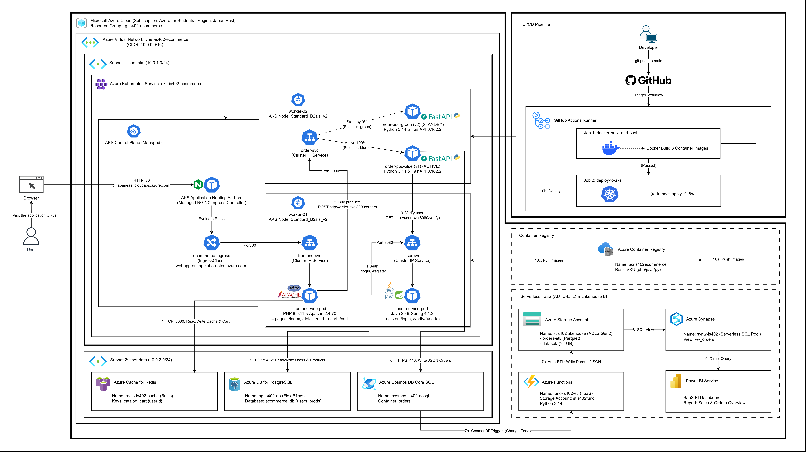

<p align="center">
  <a href="https://www.uit.edu.vn/" title="Trường Đại học Công nghệ Thông tin">
    
  </a>
</p>
<h1 align="center"><b>IS402.R11 - ĐIỆN TOÁN ĐÁM MÂY</b></h1>
<p align="center"><b>Thiết kế Kiến trúc Hệ thống Cloud-Native E-Commerce trên Microsoft Azure (Nhánh Web)</b></p>

---

## MỤC LỤC
- [1. Tổng quan Kiến trúc & Danh mục Phiên bản Công nghệ](#1-tổng-quan-kiến-trúc--danh-mục-phiên-bản-công-nghệ)
- [2. Sơ đồ Kiến trúc Hệ thống (ASCII Diagram)](#2-sơ-đồ-kiến-trúc-hệ-thống-ascii-diagram)
- [3. Phân loại theo Mô hình Dịch vụ Đám mây (IaaS, PaaS, FaaS, SaaS)](#3-phân-loại-theo-mô-hình-dịch-vụ-đám-mây-iaas-paas-faas-saas)
- [4. Thiết kế Web 4 Trang & 2 Microservices trên AKS (Barem Mục 4)](#4-thiết-kế-web-4-trang--2-microservices-trên-aks-barem-mục-4)
- [5. Mô hình Lưu trữ Đa tầng & Luồng Dữ liệu (Barem Mục 2 & 3)](#5-mô-hình-lưu-trữ-đa-tầng--luồng-dữ-liệu-barem-mục-2--3)
- [6. Cơ chế Triển khai Blue/Green & Tự động hóa CI/CD](#6-cơ-chế-triển-khai-bluegreen--tự-động-hóa-cicd)
- [7. Thiết kế Thực nghiệm Đo kiểm Hiệu năng (Benchmark & Latency)](#7-thiết-kế-thực-nghiệm-đo-kiểm-hiệu-năng-benchmark--latency)

---

## 1. Tổng quan Kiến trúc & Danh mục Phiên bản Công nghệ

Hệ thống Thương mại điện tử được thiết kế theo kiến trúc **Cloud-Native** trên nền tảng **Microsoft Azure**, tập trung vào **Nhánh hiện thực Web** trong Barem chấm điểm:
- **Nhóm bài toán (Mục 1.1):** Kết hợp **Web ứng dụng**, **Thu thập & Lưu trữ dữ liệu đa mô hình**, **Xử lý tự động (FaaS ETL)** và **Trực quan hóa tổng quan**.
- **Cơ chế định tuyến biên (Edge Ingress & DNS):** Sử dụng **AKS Application Routing Add-on (Managed NGINX Ingress Controller `v1.11`)** có sẵn của Azure (`IngressClass: webapprouting.kubernetes.azure.com`) kết hợp với tên miền miễn phí của Azure (`http://is402-ecommerce.japaneast.cloudapp.azure.com` thông qua `azure-dns-label-name`) để định tuyến lưu lượng HTTP vào cụm, trong khi toàn bộ 3 dịch vụ (`Frontend Web`, `User Service`, `Order Service`) đều chạy an toàn qua `ClusterIP` nội bộ.

### Bảng Phiên bản Công nghệ Chuẩn hóa

| Nhóm Thành phần | Công nghệ / Dịch vụ | Phiên bản (Version) | Vai trò trong Hệ thống |
|:---|:---|:---:|:---|
| **Container Orchestration** | Azure Kubernetes Service (AKS) | `v1.32` | Điều phối container và quản lý cụm K8s |
| **Ingress Controller & DNS** | AKS Application Routing Add-on (Managed NGINX) | `NGINX Ingress v1.11` | Định tuyến HTTP (L7 Path-based Routing) qua domain `*.cloudapp.azure.com` |
| **Frontend Workload** | PHP & Apache HTTP Server | `PHP 8.5.11` / `Apache 2.4.70` | Kết xuất 4 trang Web SSR và giao tiếp REST nội bộ |
| **Microservice 1 (Auth/User)** | Java & Spring Boot | `Java 25` / `Spring Boot 4.1.2` | Đăng ký, đăng nhập và xác thực tài khoản người dùng |
| **Microservice 2 (Order)** | Python & FastAPI | `Python 3.14` / `FastAPI 0.162.2` | Xử lý mua sản phẩm, gọi User Service, hỗ trợ Blue/Green |
| **In-Memory Cache & Cart** | Azure Cache for Redis | `Redis 7.2` | Lưu cache sản phẩm (`< 1ms`) và giỏ hàng người dùng |
| **Relational Database** | Azure DB for PostgreSQL | `Flexible Server v18` | Lưu trữ ACID cho bảng `users` và `products` |
| **NoSQL Document DB** | Azure Cosmos DB | `Core (SQL) API v4` | Lưu trữ đơn hàng JSON (`orders`) độ trễ `< 10ms` |
| **Serverless FaaS** | Azure Functions | `Runtime v4` (`Python 3.14`) | Bắt sự kiện đơn hàng mới và tự động ETL sang Storage |
| **Data Lake Storage** | Azure Blob Storage / ADLS Gen2 | `StorageV2` (`Parquet Snappy`) | Lưu dữ liệu ETL đơn hàng và Dataset Benchmark `> 4GB` |
| **Analytics & BI** | Azure Synapse & Power BI | `Serverless SQL` / `Power BI SaaS` | Truy vấn SQL trên Storage và hiển thị Dashboard cơ bản |
| **CI/CD & Registry** | GitHub Actions & ACR | `Actions v4` / `Docker 27.x` | Tự động hóa build container image và deploy lên AKS |

---

## 2. Sơ đồ Kiến trúc Hệ thống (Tỉ lệ chuẩn 16:9)

### 2.1 Bản vẽ Kiến trúc Chính thức
<p align="center">
  
</p>

### 2.2 Sơ đồ ASCII Master Diagram (Tỉ lệ 16:9)

```text
               ┏━━━━━━━━━━━━━━━━━━━━━━━━━━━━━━━━━━━━━━━━━━━━━━━━━━━━━━━━━━━━━━━━━━━━━━━━━━━━━━━━━━━━━━━━━━━━━━━━━━━━━━━━━━━━━━━━━━━━━━━━┓  ┌───────────────────────────────────────────────────────────┐
               ┃ MICROSOFT AZURE CLOUD (Subscription: Azure for Students | Region: Japan East)                                          ┃  │ EXTERNAL CI/CD PIPELINE (Outside Azure Resource Group)    │
               ┃ Resource Group: rg-is402-ecommerce                                                                                     ┃  │                                                           │
               ┃                                                                                                                        ┃  │              ┌───────────────────────────┐                │
               ┃  ┌──────────────────────────────────────────────────────────────────────────────────────────────────────────────────┐  ┃  │              │        [Developer]        │                │
               ┃  │ Azure Virtual Network: vnet-is402-ecommerce (CIDR: 10.0.0.0/16)                                                  │  ┃  │              └─────────────┬─────────────┘                │
               ┃  │                                                                                                                  │  ┃  │                            │ git push to main             │
               ┃  │  ┌────────────────────────────────────────────────────────────────────────────────────────────────────────────┐  │  ┃  │                            ▼                              │
               ┃  │  │ Subnet 1: snet-aks (10.0.1.0/24)                                                                           │  │  ┃  │              ┌───────────────────────────┐                │
               ┃  │  │ ┌────────────────────────────────────────────────────────────────────────────────────────────────────────┐ │  │  ┃  │              │    [GitHub Repository]    │                │
               ┃  │  │ │ Azure Kubernetes Service: aks-is402-ecommerce (K8s v1.32)                                              │ │  │  ┃  │              └─────────────┬─────────────┘                │
               ┃  │  │ │                                                                                                        │ │  │  ┃  │                            │ Trigger Workflow             │
               ┃  │  │ │ ┌────────────────────────────┐  ┌────────────────────────────────────────────────────────────────────┐ │ │  │  ┃  │                            ▼                              │
               ┃  │  │ │ │ ┌────────────────────────┐ │  │ worker-02 (AKS Node: Standard_B2als_v2)                            │ │ │  │  ┃  │    ┌─────────────────────────────────────────────────┐    │
               ┃  │  │ │ │ │   AKS Control Plane    │◄┼──┼────────────────────────────────────────────────────────────────────┼─┼─┼──╂──┼────┼───┐  GitHub Actions Runner (Actions v4)             │   │
               ┃  │  │ │ │ │   (Managed API/etcd)   │ │  │                                     Standby 0%     ┌─────────────┐ │ │ │  │  ┃  │    │   │  ┌─────────────────────────────────────────┐    │ │
               ┃  │  │ │ │ └────────────────────────┘ │  │  ┌───────────────────────┐       (selector: green) │[order-pod-  │ │ │ │  │  ┃  │    │   │  │ [Job 1: docker-build-and-push]          ├──┐ │ │
               ┃  │  │ │ │                            │  │  │ [svc: order-svc:8000] ├ - - - - - - - - - - - -►│ green] (v2) │ │ │ │  │  ┃  │    │   │  │ - Docker 27.x Build 3 Container Images  │  │ │ │
               ┃  │  │ │ │ ┌────────────────────────┐ │  │  │ (ClusterIP Service)   │                         │ (STANDBY)   │ │ │ │  │  ┃  │    │   │  └────────────────────┬────────────────────┘  │ │ │
[User]         ┃  │  │ │ │ │  AKS App Routing Addon │ │  │  │ Blue/Green Switcher   │      Active 100%        └─────────────┘ │ │ │  │  ┃  │    │   │                       │ (Passed)              │ │ │
  │            ┃  │  │ │ │ │ (Managed NGINX Ingress │ │  │  │                       ├────────────────────────►┌─────────────┐ │ │ │  │  ┃  │    │   │                       ▼                       │ │ │
  ▼            ┃  │  │ │ │ │   Controller v1.11)    │ │  │  └───────────▲───────────┘      (selector: blue)   │[order-pod-  │ │ │ │  │  ┃  │    │   │  ┌─────────────────────────────────────────┐  │ │ │
[Browser] ─────╂──┼──┼─┼─┼─► - app-routing-system   │ │  │              │ (Port 8000)                         │ blue] (v1)  ├─┼─┐ │  │  ┃  │    │   └──┤ [Job 2: deploy-to-aks]                  │  │ │ │
(HTTP :80      ┃  │  │ │ │ └───────────┬────────────┘ │  │              │                                     │ (ACTIVE)    │ │ │ │  │  ┃  │    │      │ - kubectl apply -f k8s/ (10b. Deploy)   │  │ │ │
 *.cloudapp.   ┃  │  │ │ │             │ Evaluate     │  │              │                                     │ Python 3.14 │ │ │ │  │  ┃  │    │      └─────────────────────────────────────────┘  │ │ │
 azure.com)    ┃  │  │ │ │             ▼ Rules        │  │              │                                     │ & FastAPI   │ │◄┼─┼──┼─┐┃  │    └───────────────────────────────────────────────────┼─┘ │
               ┃  │  │ │ │ ┌────────────────────────┐ │  └──────────────┼─────────────────────────────────────┼──────┬──────┘ │ │ │  │ │┃  └────────────────────────────────────────────────────────┼───┘
               ┃  │  │ │ │ │ [ing: ecommerce-       │ │                 │ (2. Buy product:                    │      │        │ │ │  │ │┃                                                           │
               ┃  │  │ │ │ │       ingress]         │ │                 │  POST http://order-svc:8000/orders) │      │(3.Veri-│ │ │  │ │┗━━━━━━━━━━━━━━━━━━━━━━━━━━━━━━━━━━━━━━━━━━━━━━━━━━━━━━━┿━━━━━━┓
               ┃  │  │ │ │ │ (webapprouting.k8s...) │ │                 │                                     │      │ fy: GET│ │ │  │ │ ┌──────────────────────────────────────────────────────┼───┐  ┃
               ┃  │  │ │ │ └───────────┬────────────┘ │  ┌──────────────┼─────────────────────────────────────┼──────┼──────┐ │ │ │  │ │ │ CONTAINER REGISTRY (Inside rg-is402-ecommerce)       │   │  ┃
               ┃  │  │ │ │             │ Port 80      │  │ worker-01    │  (AKS Node: Standard_B2als_v2)      │      ▼      │ │ │ │  │ │ │                                    (10a. Push Images)▼   │  ┃
               ┃  │  │ │ │             │              │  │  ┌───────────┼───────────┐            ┌────────────┴───────────┐ │ │◄┼─┼──┼─┴─┼─(10c. Pull Images) ───── ┌────────────────────────────┐  │  ┃
               ┃  │  │ │ │             └──────────────┼──┼─►│ [svc: frontend-svc]   │            │ [svc: user-svc]        │ │ │ │ │  │   │  (into worker-01 & 02)   │ [ACR: acris402ecommerce]   │  │  ┃
               ┃  │  │ │ │                            │  │  │ (ClusterIP :80)       │   ┌───────►│ (ClusterIP :8080)      │ │ │ │ │  │   │                         │ - Azure Container Registry  │  │  ┃
               ┃  │  │ │ │                            │  │  └───────────┬───────────┘   │        └────────────┬───────────┘ │ │ │ │  │   │                         │ - Basic SKU (php/java/py)   │  │  ┃
               ┃  │  │ │ │                            │  │              │               │ (1. Auth:           │             │ │ │ │  │   │                         └─────────────────────────────┘  │  ┃
               ┃  │  │ │ │                            │  │              ▼               │  /login, /register) ▼             │ │ │ │  │   └──────────────────────────────────────────────────────────┘  ┃
               ┃  │  │ │ │                            │  │  ┌───────────────────────┐   │        ┌────────────────────────┐ │ │ │ │  │                                                                 ┃
               ┃  │  │ │ │                            │  │  │ [frontend-web-pod]    ├───┘        │ [user-service-pod]     │ │ │ │ │  │   ┌──────────────────────────────────────────────────────────┐  ┃
               ┃  │  │ │ │                            │  │  │ PHP 8.5.11 & Apache   │            │ Java 25 & Spring 4.1.2 │ │ │ │ │  │   │ SERVERLESS FaaS (AUTO-ETL) & LAKEHOUSE BI (> 4GB)        │  ┃
               ┃  │  │ │ │                            │  │  │ 2.4.70 (4 pages Web)  │            │ /register,/login,/verif│ │ │ │ │  │   │ (Inside rg-is402-ecommerce)                              │  ┃
               ┃  │  │ │ │                            │  │  └───────┬───────────────┘            └────────┬───────────────┘ │ │ │ │  │   │                                                          │  ┃
               ┃  │  │ │ └────────────────────────────┘  └──────────┼─────────────────────────────────────┼─────────────────┘ │ │ │  │   │  ┌────────────────────────┐      ┌────────────────────┐  │  ┃
               ┃  │  │ └────────────────────────────────────────────┼─────────────────────────────────────┼───────────────────┘ │ │  │   │  │ [Azure Storage Account]│      │ [Azure Synapse]    │  │  ┃
               ┃  │  └──────────────────────────────────────────────┼─────────────────────────────────────┼─────────────────────┘ │  │   │  │ (ADLS Gen2 - HNS On)   ├─────►│ Serverless SQL Pool│  │  ┃
               ┃  │                                                 │                                     │                       │  │   │  │ - stis402lakehouse     │ (8.  │ - synw-is402       │  │  ┃
               ┃  │        (4. TCP :6380: Read/Write Cache & Cart)  │   (5. TCP :5432: Users & Products)  │ (6. HTTPS :443:       │  │   │  │ - orders-etl/ (Parquet)│  SQL │ - View: vw_orders  │  │  ┃
               ┃  │                                                 │                                     │  Write JSON Orders)   │  │   │  │ - dataset/ (> 4GB)     │ View)└─────────┬──────────┘  │  ┃
               ┃  │  ┌──────────────────────────────────────────────┼─────────────────────────────────────┼───────────────────┐   │  │   │  └───────────▲────────────┘                │ (9. Direct  │  ┃
               ┃  │  │ Subnet 2: snet-data (10.0.2.0/24)            ▼                                     ▼                   ▼   │  │   │              │ (7b. Auto-ETL:              ▼     Query)  │  ┃
               ┃  │  │  ┌──────────────────────────────────┐  ┌──────────────────────────────────┐  ┌───────────────────────────┐ │  │   │              │  Write Parquet)      ┌────────────────────┐  ┃
               ┃  │  │  │ [Azure Cache for Redis 7.2]      │  │ [Azure DB for PostgreSQL v18]    │  │ [Azure Cosmos DB SQL v4]  │ │  │   │  ┌───────────┴────────────┐      │ [Power BI Service] │  │  ┃
               ┃  │  │  │ - Name: redis-is402-cache (Basic)│  │ - Name: pg-is402-db (Flex B1ms)  │  │ - Name: cosmos-is402-nosql│ │  │   │  │ [Azure Functions v4]   │      │ - SaaS BI Dashboard│  │  ┃
               ┃  │  │  │ - Keys: catalog, cart:{userId}   │  │ - DB: ecommerce_db (users, prods)│  │ - Container: orders       │ │  │   │  │ - func-is402-etl (FaaS)│      │ - Report: Sales &  │  │  ┃
               ┃  │  │  └──────────────────────────────────┘  └──────────────────────────────────┘  └─────────────┬─────────────┘ │  │   │  │ - Python 3.14          │      │   Orders Overview  │  │  ┃
               ┃  │  └────────────────────────────────────────────────────────────────────────────────────────────┼───────────────┘  │   │  └───────────▲────────────┘      └────────────────────┘  │  ┃
               ┃  └───────────────────────────────────────────────────────────────────────────────────────────────┼──────────────────┘   └──────────────┼──────────────────────────────────────────┘    ┃
               ┃                                                                                                  └──── (7a. CosmosDBTrigger: Change Feed) ─┘                                           ┃
               ┗━━━━━━━━━━━━━━━━━━━━━━━━━━━━━━━━━━━━━━━━━━━━━━━━━━━━━━━━━━━━━━━━━━━━━━━━━━━━━━━━━━━━━━━━━━━━━━━━━━━━━━━━━━━━━━━━━━━━━━━━━━━━━━━━━━━━━━━━━━━━━━━━━━━━━━━━━━━━━━━━━━━━━━━━━━━━━━━━━━━━━━━━┛
```

---

## 3. Phân loại theo Mô hình Dịch vụ Đám mây (IaaS, PaaS, FaaS, SaaS)

*(Đáp ứng Mục 1.4 Barem chấm điểm: 0.25đ)*

| Mô hình | Thành phần sử dụng trong dự án | Vai trò chính |
|:---|:---|:---|
| **IaaS**<br>*(Hạ tầng)* | • **AKS Worker Nodes (Azure VM):** Máy ảo Ubuntu Linux chạy container.<br>• **Azure Virtual Network (VNet) & NSG:** Hạ tầng mạng ảo và tường lửa kết nối các dịch vụ. | Cung cấp tài nguyên tính toán (vCPU, RAM, Network) nền tảng cho cụm Kubernetes. |
| **PaaS**<br>*(Nền tảng)* | • **AKS Control Plane (`v1.32`) & Application Routing Add-on (Managed NGINX Ingress):** Điều phối container và định tuyến Ingress tự động.<br>• **Azure DB for PostgreSQL (`v18`):** CSDL quan hệ lưu tài khoản & sản phẩm.<br>• **Azure Cache for Redis (`7.2`):** Bộ nhớ đệm In-Memory lưu cache & giỏ hàng.<br>• **Azure Cosmos DB (`Core SQL v4`):** CSDL NoSQL lưu đơn hàng.<br>• **Azure Storage (Blob / ADLS Gen2):** Lưu trữ dữ liệu ETL và Dataset `> 4GB`.<br>• **Azure Synapse Analytics:** Truy vấn Serverless SQL trên dữ liệu lớn.<br>• **Azure Container Registry (ACR):** Lưu trữ Docker Images riêng tư. | Cung cấp các nền tảng cơ sở dữ liệu, lưu trữ và xử lý được quản lý toàn diện bởi Azure (không cần tự cài đặt/bảo trì OS hay DB engine). |
| **FaaS**<br>*(Chức năng)* | • **Azure Functions v4 (`Python 3.14` - Flex Consumption):** Hàm Serverless tự động kích hoạt khi có đơn hàng mới để thực hiện ETL sang Storage. | Thực thi mã theo sự kiện (Event-driven), tự động scale to zero và chỉ tính phí theo số lần chạy thực tế. |
| **SaaS**<br>*(Phần mềm)* | • **Power BI Service:** Công cụ hiển thị biểu đồ tổng quan trên trình duyệt.<br>• **GitHub & GitHub Actions:** Quản lý mã nguồn, cộng tác nhóm và chạy CI/CD. | Phần mềm hoàn chỉnh chạy trên đám mây phục vụ trực tiếp người dùng cuối và nhóm phát triển. |

---

## 4. Thiết kế Web 4 Trang & 2 Microservices trên AKS (Barem Mục 4)

Hệ thống trên AKS gồm **1 ứng dụng Frontend Web** và **2 Microservices nghiệp vụ** (đều chạy `ClusterIP` và được định tuyến qua **AKS Application Routing Add-on - Managed NGINX Ingress Controller `v1.11`** `IngressClass: webapprouting.kubernetes.azure.com` với tên miền miễn phí `http://is402-ecommerce.japaneast.cloudapp.azure.com`) viết bằng 3 ngôn ngữ theo đúng điều kiện đề bài (**PHP 8.5.11, Java 25, Python 3.14**):

### 4.1 Frontend Web Service — Đủ 4 Trang Chức năng (1.0đ)
- **Công nghệ:** `PHP 8.5.11` + `Apache 2.4.70` (Định tuyến qua Managed NGINX Ingress tại đường dẫn `/` trên domain `*.japaneast.cloudapp.azure.com`).
- **4 Trang bắt buộc theo Barem:**
  1. **Trang chủ (`/index.php`):** Hiển thị danh sách sản phẩm. Ưu tiên đọc từ **Azure Cache for Redis 7.2** (nếu chưa có cache thì lấy từ PostgreSQL v18 rồi nạp vào Redis).
  2. **Trang chi tiết sản phẩm (`/detail.php?id=...`):** Hiển thị thông tin chi tiết (tên, mô tả, giá bán) của sản phẩm được chọn và nút "Thêm vào giỏ hàng".
  3. **Trang thêm vào giỏ hàng (`/add-to-cart.php`):** Tiếp nhận sản phẩm và số lượng người dùng chọn, cập nhật vào giỏ hàng của người dùng lưu trên **Azure Cache for Redis 7.2** và thông báo kết quả.
  4. **Trang liệt kê giỏ hàng & Mua hàng (`/cart.php`):** Liệt kê các mặt hàng đã thêm từ Redis, tính tổng tiền và cung cấp nút **"Mua sản phẩm"** (gửi yêu cầu đặt hàng sang Order Service qua ClusterIP).

### 4.2 Hai Microservices Nghiệp vụ & Giao tiếp Liên Dịch vụ (1.0đ)
1. **Service 1 — Đăng ký tài khoản người dùng (`User Service`):**
   - **Công nghệ:** `Java 25` + `Spring Boot 4.1.2` (`ClusterIP: user-svc:8080`).
   - **Cơ sở dữ liệu:** **Azure Database for PostgreSQL Flexible Server v18** (bảng `users` và bảng `products`).
   - **Endpoints chính:**
     - `POST /api/users/register`: Đăng ký tài khoản người dùng mới.
     - `POST /api/users/login`: Đăng nhập và trả về thông tin định danh (`userId`).
     - `GET /api/users/verify/{userId}`: API nội bộ để `Order Service` kiểm tra tài khoản có tồn tại và hợp lệ hay không.
2. **Service 2 — Mua sản phẩm (`Order Service`):**
   - **Công nghệ:** `Python 3.14` + `FastAPI 0.162.2` (`ClusterIP: order-svc:8000`).
   - **Cơ sở dữ liệu:** **Azure Cosmos DB (Core SQL API v4)** — container `orders` (Partition Key: `/userId`).
   - **Cơ chế giao tiếp giữa 2 Service:**
     - Khi người dùng bấm "Mua sản phẩm", Frontend PHP gửi `userId` và danh sách mặt hàng tới `POST http://order-svc:8000/api/orders` của **Order Service (Python 3.14)**.
     - **Order Service (Python 3.14)** gọi HTTP GET nội bộ qua K8s DNS (`http://user-svc:8080/api/users/verify/{userId}`) sang **User Service (Java 25)**.
     - Nếu User Service xác nhận người dùng hợp lệ (`HTTP 200`), Order Service tạo bản ghi đơn hàng và lưu vào **Azure Cosmos DB**.

---

## 5. Mô hình Lưu trữ Đa tầng & Luồng Dữ liệu (Barem Mục 2 & 3)

### 5.1 Tổ chức Định dạng Lưu trữ Đa mô hình (Barem Mục 2.1)

| Dịch vụ Azure | Định dạng & Cấu trúc lưu trữ | Dữ liệu lưu trữ trong dự án | Lý do lựa chọn & Tối ưu hóa (Mục 3.4) |
|:---|:---|:---|:---|
| **Azure DB for PostgreSQL v18** | Quan hệ (Relational Tables), B-Tree Index | Bảng `users` (tài khoản) & bảng `products` (danh mục gốc) | Đảm bảo tính toàn vẹn ACID cho dữ liệu tài khoản và danh mục chuẩn. |
| **Azure Cache for Redis 7.2** | In-Memory Key-Value (`String` / `Hash`, JSON) | Key `catalog:products` (Cache SP) & `cart:{userId}` (Giỏ hàng) | Độ trễ `< 1ms`, giảm tải truy vấn lặp lại vào PostgreSQL (**Cache-Aside Pattern**). |
| **Azure Cosmos DB (Core SQL v4)** | NoSQL Document (JSON bán cấu trúc) | Container `orders` (Đơn mua hàng của khách) | Ghi dữ liệu đơn hàng tốc độ cao (`< 10ms`), linh hoạt schema và hỗ trợ Change Feed. |
| **Azure Storage (ADLS Gen2 / Blob)** | Tập tin Cột nén (`Apache Parquet`) & `CSV/JSON` | Dữ liệu đơn hàng ETL từ Web + **Dataset lịch sử `> 4GB`** | Lưu trữ dung lượng lớn chi phí rẻ, định dạng cột Parquet giúp Synapse quét dữ liệu cực nhanh. |

### 5.2 Luồng Xử lý Dữ liệu Tự động ETL bằng FaaS (Barem Mục 3.2 & 4.4 — 1.0đ)
Dự án thiết kế một luồng **Event-driven Auto-ETL** thống nhất:
1. **Receive (Web -> Cosmos DB):** Khách hàng đặt mua trên Web -> `Order Service` ghi đơn hàng mới vào container `orders` trên **Azure Cosmos DB**.
2. **Detect & Extract (Cosmos DB -> Azure Functions):** Ngay khi có đơn hàng mới, **Azure Functions v4 (`Python 3.14`)** được kích hoạt tự động (thông qua Cosmos DB Trigger / Change Feed).
3. **Transform & Load (Azure Functions -> Azure Storage):** Hàm Function trích xuất các trường quan trọng (`orderId`, `userId`, `totalAmount`, `itemsCount`, `createdAt`), chuẩn hóa định dạng và ghi tự động vào thư mục `orders-etl/` trên **Azure Storage (Blob / ADLS Gen2)**.
4. **Analyze & Visualize (Storage -> Synapse -> Power BI):** **Azure Synapse Serverless SQL** đọc dữ liệu từ Storage qua View SQL và cung cấp cho **Power BI** hiển thị biểu đồ tổng quan doanh thu/đơn hàng.

---

## 6. Cơ chế Triển khai Blue/Green & Tự động hóa CI/CD

### 6.1 Triển khai Blue/Green trên AKS (Barem Mục 4.2 — 0.5đ)
- Trên AKS tồn tại song song 2 Deployment của dịch vụ mua hàng (`Python 3.14` & `FastAPI 0.162.2`):
  - `order-service-blue` (nhãn `app: order, version: blue` — trả về `"version": "v1-blue"`).
  - `order-service-green` (nhãn `app: order, version: green` — trả về `"version": "v2-green"`).
- Kubernetes Service `order-svc` (`ClusterIP`) đóng vai trò bộ chuyển mạch thông qua trường `selector`.
- Khi cần chuyển từ bản Blue sang bản Green với **0% Downtime**, chỉ cần cập nhật selector của `order-svc` sang `version: green` bằng lệnh `kubectl patch service`.

### 6.2 Tự động hóa CI/CD qua GitHub Actions
- Khi thành viên push code lên nhánh `main` trên GitHub:
  1. **GitHub Actions** tự động chạy `docker build` cho 3 service (`frontend-php`, `user-service`, `order-service`).
  2. Đẩy Docker Images mới lên **Azure Container Registry (ACR)**.
  3. Tự động chạy `kubectl apply` để cập nhật các Deployment trên cụm **AKS v1.32**.

---

## 7. Thiết kế Thực nghiệm Đo kiểm Hiệu năng (Benchmark & Latency)

Để lấy trọn điểm thực nghiệm ở **Mục 1.3 (0.75đ)** và **Mục 3.1, 3.3, 3.4 (1.5đ)**, dự án thiết kế 3 kịch bản đo kiểm rõ ràng:

### 7.1 Thực nghiệm 1: Xử lý Dataset `> 4GB` — Máy chủ Truyền thống (Local) vs Cloud (Mục 1.3)
- **Chuẩn bị:** Tập dữ liệu lịch sử giao dịch thương mại điện tử dung lượng **`> 4GB`** đặt trên máy Local và trên **Azure Storage (ADLS Gen2)**.
- **Thực hiện:** Chạy cùng một truy vấn tổng hợp (thống kê tổng doanh thu, số lượng đơn hàng theo danh mục/tháng trên toàn bộ tập `> 4GB`):
  - **Trường hợp 1 (Máy truyền thống / Local):** Chạy script xử lý trên máy cá nhân (giới hạn CPU/RAM cục bộ và tốc độ đọc ổ đĩa).
  - **Trường hợp 2 (Hệ thống Cloud):** Chạy truy vấn phân tán qua **Azure Synapse Serverless SQL Pool** trực tiếp trên tập Parquet ở Azure Storage.
- **Kết quả thu thập:** Bảng và biểu đồ so sánh thời gian hoàn thành (giây), mức tiêu thụ RAM/CPU.

### 7.2 Thực nghiệm 2: Tốc độ Đọc/Ghi & Tối ưu hóa bằng Redis Cache (Mục 3.1 & 3.4)
- **Thực hiện:** Đo thời gian phản hồi (ms) và thông lượng (requests/sec) khi ứng dụng Web truy xuất danh mục sản phẩm và giỏ hàng:
  - **Không có Cache (Direct DB):** Đọc trực tiếp từ Azure PostgreSQL v18 (`~15ms - 40ms`).
  - **Có tối ưu hóa Redis Cache-Aside:** Đọc từ Azure Cache for Redis 7.2 (`< 1ms - 3ms`).
- **Kết quả thu thập:** Bảng so sánh tốc độ đọc/ghi của PostgreSQL v18, Cosmos DB, Redis 7.2 và mức cải thiện hiệu năng nhờ Redis Cache.

### 7.3 Thực nghiệm 3: Đo Độ trễ (Delay) khi Đặt Server ở Region khác (Mục 3.3)
- **Thực hiện:** Đo độ trễ mạng và thời gian truy vấn (Latency RTT tính bằng `ms`) từ ứng dụng/script kiểm thử đặt tại **Japan East (Tokyo)** tới dịch vụ lưu trữ/DB đặt tại:
  - **Cùng Region (Same-Region):** `Japan East (Tokyo)`.
  - **Khác Region (Cross-Region):** `East US (Mỹ)` hoặc `West Europe (Châu Âu)`.
- **Kết quả thu thập:** Bảng thống kê độ trễ Min / Avg / Max / P95 (`ms`) chứng minh tác động của khoảng cách địa lý giữa các Region và giải pháp tối ưu.
