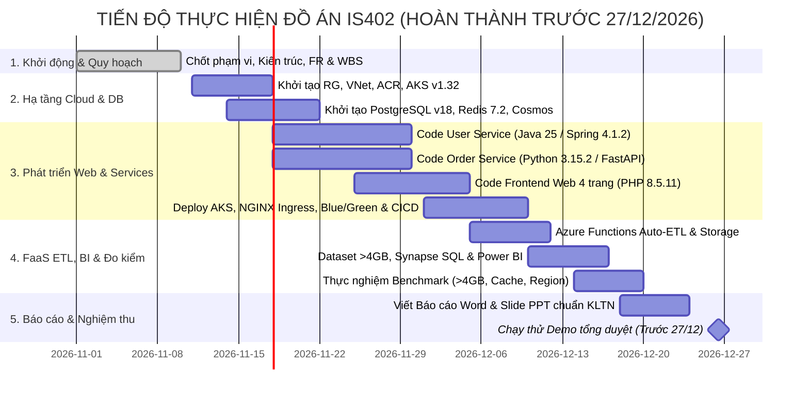

  

<h1 align="center"><b>IS402.R11 - ĐIỆN TOÁN ĐÁM MÂY</b></h1>

<b>CẤU TRÚC PHÂN RÃ CÔNG VIỆC (WORK BREAKDOWN STRUCTURE - WBS)</b>

<i>Dự án: Ứng dụng Thương mại điện tử Cloud-Native trên Microsoft Azure (Hoàn thành trước 27/12/2026)</i>

---

## MỤC LỤC
- [1. Tổng quan Lộ trình & Mốc Thời gian Quan trọng](#1-tổng-quan-lộ-trình--mốc-thời-gian-quan-trọng)
- [2. Sơ đồ Gantt Tiến độ Thực hiện](#2-sơ-đồ-gantt-tiến-độ-thực-hiện)
- [3. Bảng Phân rã Công việc Chi tiết (WBS)](#3-bảng-phân-rã-công-việc-chi-tiết-wbs)
- [4. Ma trận Phân công Trách nhiệm (RACI)](#4-ma-trận-phân-công-trách-nhiệm-raci)

---

## 1. Tổng quan Lộ trình & Mốc Thời gian Quan trọng

Toàn bộ dự án được chia làm **5 gói công việc (Work Packages)** gắn trực tiếp với từng mục điểm trong Barem môn IS402.  
- **Hạn chót hoàn thành toàn bộ đồ án (Hard Deadline):** **26/12/2026** *(Hoàn tất trước ngày 27/12/2026 để sẵn sàng cho tuần báo cáo chính thức bắt đầu từ 28/12/2026)*.
- **Nhân sự thực hiện:**
  - **Sỹ (Ngô Tiến Sỹ - 23521367):** Trưởng nhóm — Hạ tầng AKS, Managed NGINX Ingress Add-on, K8s Blue/Green, CI/CD, Đo kiểm Cross-Region & Quản lý Quotas.
  - **Đại (Lê Quốc Đại - 23520214):** Frontend Web (`PHP 8.5.11`), User Service (`Java 25` & `Spring Boot 4.1.2`), PostgreSQL v18, Redis 7.2 & Đo tốc độ Cache vs DB.
  - **Phúc (Đào Bảo Phúc - 23521192):** Order Service (`Python 3.15.2` & `FastAPI 0.162.2`), Cosmos DB, Azure Functions Auto-ETL, Synapse, Power BI & Benchmark `> 4GB`.

---

## 2. Sơ đồ Gantt Tiến độ Thực hiện

---

## 3. Bảng Phân rã Công việc Chi tiết (WBS)

| Mã WBS | Hạng mục công việc | Mô tả chi tiết: Cần làm gì & Làm thế nào (Description) | Đầu ra (Deliverables) | Mục Barem | Phụ trách | Thời hạn |
|:---:|:---|:---|:---|:---:|:---:|:---:|
| **1.0** | **Gói 1: Khởi động & Quy hoạch Kiến trúc** | **Chuẩn hóa toàn bộ phạm vi, kiến trúc và lộ trình theo đúng Barem nhánh Web.** | | **Mục 1 & 2** | | **09/11/2026** |
| 1.1 | Xác định bài toán & phân loại dịch vụ Cloud | Xác định rõ phạm vi nhánh Web, ngân sách `$100` Azure for Students và lập bảng phân loại chi tiết các dịch vụ thuộc IaaS, PaaS, FaaS, SaaS. | `project-charter.md` | Mục 1.1, 1.4 | Sỹ | 08/11/2026 |
| 1.2 | Thiết kế kiến trúc & luồng dữ liệu | Vẽ sơ đồ kiến trúc tổng thể (`architecture.png` & ASCII Master Diagram 16:9); định nghĩa cấu trúc lưu trữ (PostgreSQL, Redis, Cosmos DB, Storage ADLS Gen2) và luồng giao tiếp 10 bước. | `architecture.md`, `architecture.png` | Mục 2.1, 2.2 | Sỹ, Đại, Phúc | 09/11/2026 |
| 1.3 | Đặc tả chức năng & lập kế hoạch WBS | Chốt 10 yêu cầu chức năng (FR-01 đến FR-10) không còn điểm mờ; chia gói công việc và lịch trình cho 3 thành viên hoàn tất trước 27/12. | `functional-requirements.md`, `wbs.md` | Mục 5 | Sỹ | 09/11/2026 |
| **2.0** | **Gói 2: Cấp phát Hạ tầng Azure & Cơ sở dữ liệu** | **Dùng Azure Portal / Azure CLI cấp phát tài nguyên PaaS/IaaS trong 1 Resource Group chung.** | | **Mục 2.3 & 5** | | **22/11/2026** |
| 2.1 | Tạo Resource Group chung, phân quyền IAM cho 3 thành viên | Tạo Resource Group `rg-is402-ecommerce` tại `Southeast Asia`, vào mục IAM (Access Control) gán quyền `Contributor`/`Owner` cho email của 3 thành viên và cài đặt Budget Alert. | Ảnh chụp IAM & Cost Budget | Mục 5.4 | Sỹ | 10/11/2026 |
| 2.2 | Khởi tạo VNet, ACR & cụm AKS `v1.32` | Dùng `az acr create` và `az aks create --enable-app-routing --attach-acr` để tạo cụm AKS `v1.32` (1–2 node `Standard_D2s_v5`) có sẵn Managed NGINX Ingress. | Cụm AKS & ACR hoạt động | Yêu cầu đề | Sỹ | 10/11/2026 |
| 2.3 | Khởi tạo PostgreSQL `v18` & Redis `7.2` | Tạo Azure DB for PostgreSQL Flexible Server (`B1ms`), chạy script SQL tạo bảng `users` & `products` (nạp sẵn 15 sản phẩm mẫu); tạo Azure Cache for Redis (`Basic C0`). | Connection strings & DB Schema | Yêu cầu đề | Đại | 20/11/2026 |
| 2.4 | Khởi tạo Cosmos DB & Azure Storage | Tạo tài khoản Azure Cosmos DB (`Core SQL API`, bật Free Tier), tạo database `ecommerce` & container `orders` (`PartitionKey: /userId`); tạo Storage Account (ADLS Gen2/Blob) gồm 2 container `orders-etl` và `benchmark-dataset`. | Cosmos DB & Storage sẵn sàng | Yêu cầu đề | Phúc | 22/11/2026 |
| **3.0** | **Gói 3: Phát triển Web, Microservices, Blue/Green & CI/CD** | **Code 3 dịch vụ (PHP, Java, Python), đóng gói Docker và triển khai lên AKS.** | | **Mục 4 (Web)** | | **10/12/2026** |
| 3.1 | Xây dựng `User Service` (`Java 25` / `Spring Boot 4.1.2`) | Dùng Spring Data JPA kết nối PostgreSQL `v18`; viết 3 REST API: `POST /api/users/register` (lưu user), `POST /api/users/login` (kiểm tra TK) và `GET /api/users/verify/{id}` (cho Order Service gọi); viết `Dockerfile`. | Mã nguồn `user-service` & Image | Mục 4.3 (1.0đ) | Đại | 30/11/2026 |
| 3.2 | Xây dựng `Order Service` (`Python 3.15.2` / `FastAPI 0.162.2`) | Viết API `POST /api/orders` nhận giỏ hàng, dùng `httpx` gọi nội bộ `GET http://user-svc:8080/api/users/verify/{id}`; nếu hợp lệ thì dùng `azure-cosmos` SDK lưu đơn vào Cosmos DB; trả kèm biến môi trường `SERVICE_VERSION` (`v1-blue` / `v2-green`). | Mã nguồn `order-service` & Image | Mục 4.3 (1.0đ) | Phúc | 30/11/2026 |
| 3.3 | Xây dựng `Frontend Web` (`PHP 8.5.11` / `Apache 2.4.70`) | Code 4 trang: `index.php` (đọc SP qua `phpredis` Cache-Aside `< 1ms`, miss mới đọc Postgres), `detail.php` (xem chi tiết SP), `add-to-cart.php` (lưu giỏ vào Redis `cart:{userId}`), `cart.php` (liệt kê giỏ & nút bấm gọi `POST /api/orders`). | Mã nguồn `frontend-php` & Image | Mục 4.1 (1.0đ) | Đại | 05/12/2026 |
| 3.4 | Cấu hình NGINX Ingress (`*.cloudapp.azure.com`) & Blue/Green (`v1`/`v2`) | Viết YAML K8s cho `frontend-svc`, `user-svc`, `Ingress` (`ingressClassName: webapprouting.kubernetes.azure.com`, gắn `azure-dns-label-name: is402-ecommerce` để có domain `http://is402-ecommerce.southeastasia.cloudapp.azure.com`); tạo 2 Deployment `order-blue` & `order-green` đứng sau `order-svc` và viết script `kubectl patch svc` chuyển đổi selector không downtime. | Bộ file `k8s/*.yaml` & Script switch | Mục 4.2 (0.5đ) | Sỹ | 08/12/2026 |
| 3.5 | Thiết lập pipeline CI/CD GitHub Actions | Tạo `.github/workflows/deploy.yml`: khi push code lên `main`, tự động đăng nhập ACR, build & push 3 Docker images và chạy `kubectl apply -f k8s/` lên cụm AKS. | Workflow CI/CD chạy thành công | Yêu cầu đề | Sỹ | 10/12/2026 |
| **4.0** | **Gói 4: FaaS Auto-ETL, Synapse/Power BI & Thực nghiệm Đo kiểm** | **Triển khai hàm Serverless ETL, kết nối BI và chạy 3 kịch bản đo kiểm lấy số liệu.** | | **Mục 1.3, 3, 4.4** | | **20/12/2026** |
| 4.1 | Xây dựng `Azure Functions v4` (`Python 3.15.2`) Auto-ETL | Dùng `CosmosDBTrigger` trong Azure Functions lắng nghe container `orders`; mỗi khi có đơn mới, tự động trích xuất (`orderId`, `userId`, `totalAmount`, `createdAt`) và dùng `azure-storage-blob` ghi file vào `orders-etl/` trên Azure Storage. | Function App chạy tự động trên Azure | Mục 3.2 & 4.4 (1.0đ) | Phúc | 12/12/2026 |
| 4.2 | Nạp Dataset `> 4GB`, cấu hình Synapse & Power BI | Sinh/tải bộ dữ liệu đơn hàng E-Commerce `> 4GB` (Parquet/CSV) lên `benchmark-dataset/` trên Azure Storage; dùng lệnh `OPENROWSET` tạo View trên Synapse Serverless SQL và nối vào Power BI vẽ 1 trang biểu đồ doanh thu/đơn hàng. | Dataset `> 4GB`, View SQL & Power BI | Mục 1.3 & Đề bài | Phúc | 17/12/2026 |
| 4.3 | Thực nghiệm 1: So sánh tốc độ xử lý `> 4GB` (Local vs Cloud) | Chạy cùng một truy vấn thống kê tổng doanh thu theo danh mục/tháng trên tập dữ liệu `> 4GB`: (1) chạy bằng script Python trên máy Local và (2) chạy bằng SQL phân tán trên Azure Synapse; ghi lại thời gian chạy (giây) và mức dùng RAM/CPU. | Bảng số liệu & biểu đồ Local vs Cloud | Mục 1.3 (0.75đ) | Phúc, Sỹ | 18/12/2026 |
| 4.4 | Thực nghiệm 2: Đo tốc độ đọc/ghi & tối ưu Redis Cache | Viết script benchmark gọi 500–1000 requests đọc danh mục SP khi (1) đọc trực tiếp PostgreSQL `v18` và (2) đọc qua Redis `7.2` Cache-Aside, kèm đo tốc độ ghi đơn vào Cosmos DB; lập bảng so sánh Latency (ms) & Throughput (req/s). | Bảng số liệu Cache Hit vs DB | Mục 3.1 & 3.4 (1.0đ) | Đại | 19/12/2026 |
| 4.5 | Thực nghiệm 3: Đo độ trễ khác Region (Cross-Region) | Khởi tạo 1 Storage/DB test ở Region khác (`East US`), chạy script đo 100 lần độ trễ RTT (ms) từ cụm ứng dụng ở `Southeast Asia` tới `Southeast Asia` (Same-Region) so với tới `East US` (Cross-Region), sau đó xóa ngay resource test ở `East US`. | Bảng số liệu Latency Min/Avg/Max/P95 | Mục 3.3 (0.5đ) | Sỹ | 20/12/2026 |
| **5.0** | **Gói 5: Hoàn thiện Báo cáo, Slide & Tổng duyệt Demo** | **Tổng hợp kết quả vào Báo cáo KLTN, Slide thuyết trình và diễn tập Demo.** | | **Mục 5 (2.0đ)** | | **26/12/2026** |
| 5.1 | Biên soạn Báo cáo Word chuẩn định dạng KLTN | Trình bày đầy đủ 5 chương khớp 100% thứ tự Barem chấm điểm; kiểm tra kỹ font chữ, đánh số hình ảnh, bảng biểu và tài liệu tham khảo IEEE. | File báo cáo `.docx` hoàn chỉnh | Mục 5.2 (0.5đ) | Cả nhóm | 23/12/2026 |
| 5.2 | Thiết kế Slide PowerPoint & thống kê Quotas | Soạn Slide cô đọng theo bullet points, đưa toàn bộ biểu đồ thực nghiệm và ảnh chụp lịch sử commit GitHub, phân quyền IAM, bảng chi phí Azure Cost Management (`<$100`). | File `.pptx` + Minh chứng quản lý DA | Mục 5.1 & 5.4 (1.0đ) | Cả nhóm | 25/12/2026 |
| 5.3 | Tổng duyệt Demo toàn trình & quay video dự phòng | Chạy thử kịch bản Demo từ đầu đến cuối: Duyệt 4 trang Web -> Đăng ký/Mua hàng (2 services gọi nhau) -> Đổi Blue/Green -> Xem log Azure Functions ETL -> Xem Synapse/Power BI; quay video backup trước ngày 27/12. | Hệ thống sẵn sàng báo cáo ngày 28/12 | Mục 5.3 (0.5đ) | Cả nhóm | **26/12/2026** |

---

## 4. Ma trận Phân công Trách nhiệm (RACI)

*(R = Responsible - Thực hiện chính | A = Accountable - Chịu trách nhiệm nghiệm thu | C = Consulted - Phối hợp | I = Informed - Nắm thông tin)*

| Hạng mục | Ngô Tiến Sỹ (Leader) | Lê Quốc Đại | Đào Bảo Phúc |
|:---|:---:|:---:|:---:|
| **Hạ tầng AKS, Managed NGINX Ingress Add-on, Blue/Green & CI/CD** | **R / A** | C | C |
| **Frontend Web 4 trang (`PHP 8.5.11`) & Redis Cache (`7.2`)** | I | **R / A** | C |
| **User Service (`Java 25` / `Spring Boot 4.1.2`) & PostgreSQL (`v18`)** | I | **R / A** | C |
| **Order Service (`Python 3.15.2` / `FastAPI 0.162.2`) & Cosmos DB** | C | C | **R / A** |
| **Azure Functions (`Python 3.15.2`) Auto-ETL, Synapse & Power BI** | C | I | **R / A** |
| **Thực nghiệm Dataset `> 4GB`, Cache vs DB & Cross-Region Latency** | **R / A** | **R** (Cache/DB) | **R** (`> 4GB`) |
| **Báo cáo Word, Slide PowerPoint & Demo nghiệm thu (trước 27/12)** | **R / A** | **R** | **R** |
