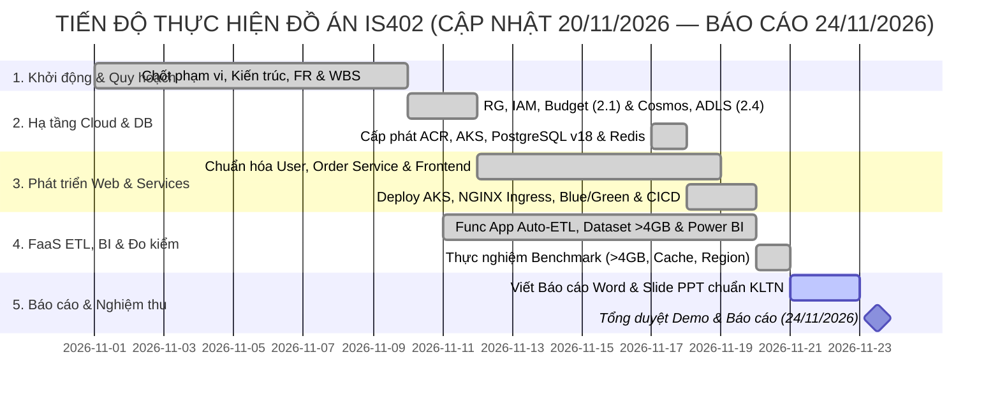

  

<h1 align="center"><b>IS402.R11 - ĐIỆN TOÁN ĐÁM MÂY</b></h1>

<b>CẤU TRÚC PHÂN RÃ CÔNG VIỆC (WORK BREAKDOWN STRUCTURE - WBS)</b>

<i>Dự án: Ứng dụng Thương mại điện tử Cloud-Native trên Microsoft Azure (Hoàn thành trước 24/11/2026)</i>

---

## MỤC LỤC
- [1. Tổng quan Lộ trình & Mốc Thời gian Quan trọng](#1-tổng-quan-lộ-trình--mốc-thời-gian-quan-trọng)
- [2. Sơ đồ Gantt Tiến độ Thực hiện](#2-sơ-đồ-gantt-tiến-độ-thực-hiện)
- [3. Bảng Phân rã Công việc Chi tiết (WBS)](#3-bảng-phân-rã-công-việc-chi-tiết-wbs)
- [4. Ma trận Phân công Trách nhiệm (RACI)](#4-ma-trận-phân-công-trách-nhiệm-raci)

---

## 1. Tổng quan Lộ trình & Mốc Thời gian Quan trọng

Toàn bộ dự án được chia làm **5 gói công việc (Work Packages)** gắn trực tiếp với từng mục điểm trong Barem môn IS402.  
- **Hạn chót hoàn thành toàn bộ đồ án (Hard Deadline):** **23/11/2026** *(Hoàn tất trước ngày báo cáo chính thức **24/11/2026**)*.
- **Nhân sự thực hiện:**
  - **Sỹ (Ngô Tiến Sỹ - 23521367):** Trưởng nhóm — Hạ tầng AKS, Managed NGINX Ingress Add-on, K8s Blue/Green, CI/CD, Đo kiểm Cross-Region & Quản lý Quotas.
  - **Đại (Lê Quốc Đại - 23520214):** Frontend Web (`PHP 8.5.11`), User Service (`Java 25` & `Spring Boot 4.1.2`), PostgreSQL v18, Redis 7.2 & Đo tốc độ Cache vs DB.
  - **Phúc (Đào Bảo Phúc - 23521192):** Order Service (`Python 3.14` & `FastAPI 0.162.2`), Cosmos DB, Azure Functions Auto-ETL, Synapse, Power BI & Benchmark `> 4GB`.

---

## 2. Sơ đồ Gantt Tiến độ Thực hiện

---

## 3. Bảng Phân rã Công việc Chi tiết (WBS)

| Mã WBS | Hạng mục công việc | Mô tả chi tiết: Cần làm gì & Làm thế nào (Description) | Đầu ra (Deliverables) | Mục Barem | Phụ trách | Thời hạn | Trạng thái |
|:---:|:---|:---|:---|:---:|:---:|:---:|:---:|
| **1.0** | **Gói 1: Khởi động & Quy hoạch Kiến trúc** | **Chuẩn hóa toàn bộ phạm vi, kiến trúc và lộ trình theo đúng Barem nhánh Web.** | | **Mục 1 & 2** | | **09/11/2026** | **✅ Hoàn thành** |
| 1.1 | Xác định bài toán & phân loại dịch vụ Cloud | Xác định rõ phạm vi nhánh Web, ngân sách `$100` Azure for Students (`$25/tháng`) và lập bảng phân loại chi tiết các dịch vụ thuộc IaaS, PaaS, FaaS, SaaS. | `PROJECT-CHARTER.md` | Mục 1.1, 1.4 | Sỹ | 08/11/2026 | ✅ Hoàn thành |
| 1.2 | Thiết kế kiến trúc & luồng dữ liệu | Vẽ sơ đồ kiến trúc tổng thể (`architecture.png` & ASCII Master Diagram 16:9); định nghĩa cấu trúc lưu trữ (PostgreSQL, Redis, Cosmos DB, Storage ADLS Gen2) và luồng giao tiếp 10 bước. | `ARCHITECTURE.md`, `architecture.png` | Mục 2.1, 2.2 | Sỹ, Đại, Phúc | 09/11/2026 | ✅ Hoàn thành |
| 1.3 | Đặc tả chức năng & lập kế hoạch WBS | Chốt 10 yêu cầu chức năng (FR-01 đến FR-10) không còn điểm mờ; chia gói công việc và lịch trình cho 3 thành viên hoàn tất trước 24/11. | `FUNCTIONAL-REQUIREMENTS.md`, `WBS.md`, `RUNBOOK.md` | Mục 5 | Sỹ | 09/11/2026 | ✅ Hoàn thành |
| **2.0** | **Gói 2: Cấp phát Hạ tầng Azure & Cơ sở dữ liệu** | **Dùng Azure Portal / Azure CLI cấp phát tài nguyên PaaS/IaaS trong 1 Resource Group chung tại `Japan East`.** | | **Mục 2.3 & 5** | | **17/11/2026** | **✅ Hoàn thành** |
| 2.1 | Tạo Resource Group chung, phân quyền IAM cho 3 thành viên | (1) Tạo `rg-is402-ecommerce` tại `Japan East`; (2) Gán quyền `Contributor` cho Đại & Phúc trong IAM; (3) Cài đặt `budget-is402-ecommerce` (`$25/tháng`). | RG, IAM & Cost Budget | Mục 5.4 | Sỹ | 10/11/2026 | ✅ Hoàn thành (`3/3`) |
| 2.2 | Khởi tạo VNet, ACR & cụm AKS | (1) Tạo `vnet-is402-ecommerce` (`snet-aks`, `snet-data`); (2) Tạo ACR `acris402ecommerce` (`Basic`); (3) Tạo cụm AKS `aks-is402-ecommerce` (`Standard_B2als_v2`, Zone 3, OS Disk `32 GiB`, Managed NGINX Ingress). | VNet, ACR & AKS sẵn sàng | Yêu cầu đề | Sỹ | 17/11/2026 | ✅ Hoàn thành (`3/3`) |
| 2.3 | Khởi tạo PostgreSQL `v18` & Redis | (1) Tạo PostgreSQL Flexible Server `pg-is402-db` (`Burstable B1ms`, `32 GiB`); (2) Chạy `database/init.sql` tạo bảng `users`, `products` + 15 SP mẫu; (3) Tạo Redis `redis-is402-cache` (`Basic C0`, TLS `6380`). | Connection strings & DB Schema | Yêu cầu đề | Đại, Sỹ | 17/11/2026 | ✅ Hoàn thành (`3/3`) |
| 2.4 | Khởi tạo Cosmos DB & Azure Storage | (1) Tạo `cosmos-is402-nosql` (`Free Tier`); (2) Tạo `stis402lakehouse` (ADLS Gen2, `Standard_LRS`, TLS 1.2); (3) Tạo 2 containers `orders-etl` & `benchmark-dataset`; (4) Tạo database `ecommerce` & container `orders` (`/userId`, `400 RU/s`). | Cosmos DB & Storage sẵn sàng | Yêu cầu đề | Sỹ, Phúc | 11/11/2026 | ✅ Hoàn thành (`4/4`) |
| **3.0** | **Gói 3: Phát triển Web, Microservices, Blue/Green & CI/CD** | **Code 3 dịch vụ (PHP, Java, Python), đóng gói Docker và triển khai lên AKS.** | | **Mục 4 (Web)** | | **20/11/2026** | **✅ Hoàn thành** |
| 3.1 | Xây dựng `User Service` (`Java 25` / `Spring Boot`) | Dùng Spring Data JPA kết nối PostgreSQL `v18`; viết 3 REST API: `POST /api/users/register`, `POST /api/users/login` và `GET /api/users/verify/{id}`; viết `Dockerfile`. | Mã nguồn `user-service` & Image trên ACR | Mục 4.3 (1.0đ) | Đại, Sỹ | 20/11/2026 | ✅ Hoàn thành |
| 3.2 | Xây dựng `Order Service` (`Python 3.14` / `FastAPI`) | Viết API `POST /api/orders` nhận giỏ hàng, dùng `httpx` gọi nội bộ `GET http://user-svc:8080/api/users/verify/{id}`; lưu đơn vào Cosmos DB; trả kèm `SERVICE_VERSION` (`v1-blue` / `v2-green`). | Mã nguồn `order-service` & Image trên ACR | Mục 4.3 (1.0đ) | Phúc, Sỹ | 20/11/2026 | ✅ Hoàn thành |
| 3.3 | Xây dựng `Frontend Web` (`PHP 8.5.11` / `Apache 2.4.70`) | Code 4 trang: `index.php` (đọc SP qua `phpredis` Cache-Aside), `detail.php`, `add-to-cart.php` (lưu giỏ vào Redis `cart:{userId}`), `cart.php` (liệt kê giỏ & nút bấm gọi `POST /api/orders`). | Mã nguồn `frontend-php` & Image trên ACR | Mục 4.1 (1.0đ) | Đại, Sỹ | 20/11/2026 | ✅ Hoàn thành |
| 3.4 | Cấu hình NGINX Ingress (`*.cloudapp.azure.com`) & Blue/Green (`v1`/`v2`) | Triển khai 4 Pods (`1/1 Running`) + `ecommerce-ingress` (`20.27.160.34`, domain `http://is402-ecommerce.japaneast.cloudapp.azure.com`); test chuyển đổi `v1-blue` $\leftrightarrow$ `v2-green` `0%` downtime thành công. | Bộ file `k8s/*.yaml` & Script switch | Mục 4.2 (0.5đ) | Sỹ, Phúc | 20/11/2026 | ✅ Hoàn thành |
| 3.5 | Thiết lập pipeline CI/CD GitHub Actions | Tạo `.github/workflows/deploy.yml` + Service Principal `sp-is402-github-cicd` (`AZURE_CREDENTIALS`): tự động build/push 3 Docker images lên ACR và rollout lên AKS khi push `main`. | Workflow CI/CD sẵn sàng | Yêu cầu đề | Sỹ | 20/11/2026 | ✅ Hoàn thành |
| **4.0** | **Gói 4: FaaS Auto-ETL, Synapse/Power BI & Thực nghiệm Đo kiểm** | **Triển khai hàm Serverless ETL, kết nối BI và chạy 3 kịch bản đo kiểm lấy số liệu.** | | **Mục 1.3, 3, 4.4** | | **20/11/2026** | **✅ Hoàn thành** |
| 4.1 | Xây dựng `Azure Functions v4` (`Python 3.14` - `Flex Consumption`) Auto-ETL | Deploy `orders_auto_etl` (`CosmosDBTrigger`) lên `func-is402-etl`; tự tạo container `leases` và tự động ETL đơn hàng sang `stis402lakehouse/orders-etl/*.jsonl` trong ~9 giây. | Function App chạy tự động trên Azure | Mục 3.2 & 4.4 (1.0đ) | Sỹ, Phúc | 20/11/2026 | ✅ Hoàn thành (`3/3`) |
| 4.2 | Nạp Dataset `> 4GB`, cấu hình Synapse & Power BI | Nạp `4.1 GB` (`81.92M` dòng) lên `benchmark-dataset/`; tạo database `ecommerce_bi` & View `dbo.vw_orders_summary` trên `synw-is402`; dựng Dashboard Power BI **`IS402 Sales & Orders Overview`**. | Dataset `4.1 GB`, View SQL & Power BI | Mục 1.3 & Đề bài | Sỹ, Phúc | 20/11/2026 | ✅ Hoàn thành (`4/4`) |
| 4.3 | Thực nghiệm 1: So sánh tốc độ xử lý `> 4GB` (Local vs Cloud) | Đo tổng hợp `4.1 GB` CSV (`81.92M` dòng): Local **`56.36 s`** vs Cloud Azure Synapse **`30.95 s`** (**nhanh hơn 1.82x**, khớp 100% doanh thu 5 danh mục). | `benchmark/RESULTS.md` & ảnh Synapse | Mục 1.3 (0.75đ) | Phúc, Sỹ | 20/11/2026 | ✅ Hoàn thành |
| 4.4 | Thực nghiệm 2: Đo tốc độ đọc/ghi & tối ưu Redis Cache | Đo PostgreSQL vs Redis Cache-Aside: Local (`7.89 ms` vs `2.33 ms`, giảm **70.5%**, **3.19x** RPS) & Cloud Azure (`394.94 ms` vs `149.26 ms`, giảm **62.2%**, **2.60x** RPS). | `benchmark/RESULTS.md` | Mục 3.1 & 3.4 (1.0đ) | Đại, Sỹ | 20/11/2026 | ✅ Hoàn thành |
| 4.5 | Thực nghiệm 3: Đo độ trễ khác Region (Cross-Region) | Đo 50 mẫu RTT giữa `Japan East` (`374.10 ms`) và `Central India` (`330.21 ms`) rồi xóa ngay `stis402india`. | `benchmark/RESULTS.md` | Mục 3.3 (0.5đ) | Sỹ | 20/11/2026 | ✅ Hoàn thành |
| **5.0** | **Gói 5: Hoàn thiện Báo cáo, Slide & Tổng duyệt Demo** | **Tổng hợp kết quả vào Báo cáo KLTN, Slide thuyết trình và diễn tập Demo.** | | **Mục 5 (2.0đ)** | | **23/11/2026** | **⏳ Sắp tới** |
| 5.1 | Biên soạn Báo cáo Word chuẩn định dạng KLTN | Trình bày đầy đủ 5 chương khớp 100% thứ tự Barem chấm điểm; kiểm tra kỹ font chữ, đánh số hình ảnh, bảng biểu và tài liệu tham khảo IEEE. | File báo cáo `.docx` hoàn chỉnh | Mục 5.2 (0.5đ) | Cả nhóm | 23/11/2026 | ⏳ Sắp tới |
| 5.2 | Thiết kế Slide PowerPoint & thống kê Quotas | Soạn Slide cô đọng theo bullet points, đưa toàn bộ biểu đồ thực nghiệm và ảnh chụp lịch sử commit GitHub, phân quyền IAM, bảng chi phí Azure Cost Management (`<$100`). | File `.pptx` + Minh chứng quản lý DA | Mục 5.1 & 5.4 (1.0đ) | Cả nhóm | 23/11/2026 | ⏳ Sắp tới |
| 5.3 | Tổng duyệt Demo toàn trình & quay video dự phòng | Chạy thử kịch bản Demo từ đầu đến cuối: Duyệt 4 trang Web -> Đăng ký/Mua hàng (2 services gọi nhau) -> Đổi Blue/Green -> Xem log Azure Functions ETL -> Xem Synapse/Power BI; quay video backup trước ngày 24/11. | Hệ thống sẵn sàng báo cáo ngày 24/11 | Mục 5.3 (0.5đ) | Cả nhóm | **23/11/2026** | ⏳ Sắp tới |

---

## 4. Ma trận Phân công Trách nhiệm (RACI)

*(R = Responsible - Thực hiện chính | A = Accountable - Chịu trách nhiệm nghiệm thu | C = Consulted - Phối hợp | I = Informed - Nắm thông tin)*

| Hạng mục | Ngô Tiến Sỹ (Leader) | Lê Quốc Đại | Đào Bảo Phúc |
|:---|:---:|:---:|:---:|
| **Hạ tầng AKS, Managed NGINX Ingress Add-on, Blue/Green & CI/CD** | **R / A** | C | C |
| **Frontend Web 4 trang (`PHP 8.5.11`) & Redis Cache (`7.2`)** | I | **R / A** | C |
| **User Service (`Java 25` / `Spring Boot 4.1.2`) & PostgreSQL (`v18`)** | I | **R / A** | C |
| **Order Service (`Python 3.14` / `FastAPI 0.162.2`) & Cosmos DB** | C | C | **R / A** |
| **Azure Functions (`Python 3.14`) Auto-ETL, Synapse & Power BI** | C | I | **R / A** |
| **Thực nghiệm Dataset `> 4GB`, Cache vs DB & Cross-Region Latency** | **R / A** | **R** (Cache/DB) | **R** (`> 4GB`) |
| **Báo cáo Word, Slide PowerPoint & Demo nghiệm thu (trước 24/11)** | **R / A** | **R** | **R** |
